# Come configurare un bridge Modbus TCP con Finder OPTA in CODESYS

Scopri come configurare Finder OPTA come server e client Modbus TCP in
CODESYS, ricevendo comandi sulle coil da un PC e inviando i relativi valori
a un secondo Finder OPTA, in modo che i quattro LED di entrambi i dispositivi
seguano gli stessi comandi.

## Panoramica

In questo tutorial utilizziamo due dispositivi Finder OPTA e un PC con
`mbpoll`. **Opta A** è il bridge: il suo server Modbus TCP riceve i comandi
dal PC e il suo client Modbus TCP scrive gli stati corrispondenti su
**Opta B**, che si comporta da server Modbus TCP. Ogni dispositivo utilizza
quattro coil per controllare i propri quattro LED.

Per prima cosa configureremo il server di Opta A e verificheremo con `mbpoll`
che ogni coil controlli il LED locale corrispondente. Poi aggiungeremo il
client di Opta A, utilizzando quattro canali ciclici Write Single Coil.
Infine adatteremo il progetto di Opta B partendo dal tutorial sul server
Modbus TCP <!-- TODO: Aggiungere il link pubblico al tutorial italiano sul server Modbus TCP quando disponibile. --> e proveremo
il bridge completo.

La configurazione del client segue l'approccio del tutorial sul client
Modbus TCP <!-- TODO: Aggiungere il link pubblico al tutorial italiano sul client Modbus TCP quando disponibile. -->, ma in questo
caso il client scrive le coil invece di leggere un Input Register.

## Obiettivi

- Configurare Opta A come server e client Modbus TCP.
- Ricevere quattro comandi sulle coil da `mbpoll` e controllare i LED di Opta A.
- Configurare quattro canali ciclici FC05 per inviare questi stati a Opta B.
- Adattare il progetto server esistente per controllare i LED di Opta B tramite
  le coil.
- Verificare ogni passaggio della comunicazione e individuare eventuali
  problemi di mappatura o connessione.

## Requisiti

Prima di iniziare, assicurati di avere:

- [PLC Finder OPTA CODESYS](https://opta.findernet.com/it/codesys) (x2).
- Alimentatori switching adatti a entrambi i dispositivi Finder OPTA.
- Cavi Ethernet (x3) e uno switch o router per collegare entrambi i dispositivi
  e il PC.
- CODESYS con il plug-in OPTA Configurator installato, come descritto nella
  [guida all'installazione](https://opta.findernet.com/it/tutorial/codesys-plugin-tutorial).
- Comunicazione Ethernet configurata, come descritto nella
  [guida Ethernet](https://opta.findernet.com/it/tutorial/codesys-via-ethernet).
- [mbpoll](https://github.com/epsilonrt/mbpoll) installato sul PC.
- Il progetto CODESYS creato nel tutorial sul server
  Modbus TCP <!-- TODO: Aggiungere il link pubblico al tutorial italiano sul server Modbus TCP quando disponibile. -->, da utilizzare
  come punto di partenza per Opta B.

Utilizza la seguente configurazione di rete, coerente con il tutorial sul client:

- PC: `10.0.0.1`, invia i comandi con `mbpoll`.
- Opta A: `10.0.0.3`, si comporta da server e client.
- Opta B: `10.0.0.2`, si comporta da server.
- Maschera di sottorete: `255.255.255.0` su tutti e tre i dispositivi.

Entrambi i server sono in ascolto sulla porta TCP `502`. Tutti i dispositivi
comunicano nella stessa sottorete; il gateway serve solo per raggiungere altre
reti. Mantieni un'impostazione del gateway adatta alla tua rete.

Se entrambi i Finder OPTA hanno ancora l'indirizzo di fabbrica `10.0.0.2`,
collegali uno alla volta e modifica l'indirizzo di Opta A in `10.0.0.3` prima
di collegarli insieme. Se necessario, segui la [guida alla configurazione
dell'indirizzo IP](https://opta.findernet.com/it/tutorial/change-ip-codesys).

## Le coil e il funzionamento del bridge

Una coil è un valore Modbus di un singolo bit che un client può leggere e
scrivere: `1` significa ON e `0` significa OFF. In questo tutorial utilizziamo
quattro coil per controllare i quattro LED di ciascun Finder OPTA.

Modbus utilizza i codici funzione per specificare l'operazione richiesta dal client:

- FC01 (Read Coils): legge lo stato di una o più coil.
- FC05 (Write Single Coil): scrive lo stato di una coil.
- FC15 (Write Multiple Coils): scrive gli stati di più coil.

Il bridge utilizza quattro canali FC05 per inviare gli stati delle coil da
Opta A a Opta B, una coil per canale.

Ogni coil ha un indirizzo. Utilizziamo gli indirizzi `0`, `1`, `2` e `3` per
i LED 1, 2, 3 e 4 su entrambi i dispositivi.

Il PC invia i comandi a Opta A, che aggiorna i propri LED e inoltra gli stessi
valori a Opta B. In questo modo i LED di entrambi i dispositivi seguono gli
stessi comandi ON/OFF.

## Configurazione di Opta A per ricevere i comandi

In questa prima fase Opta B può rimanere scollegato. Dobbiamo verificare che
il PC possa accendere e spegnere ciascun LED di Opta A tramite il suo server
locale.

### Creazione progetto CODESYS

Apri CODESYS.

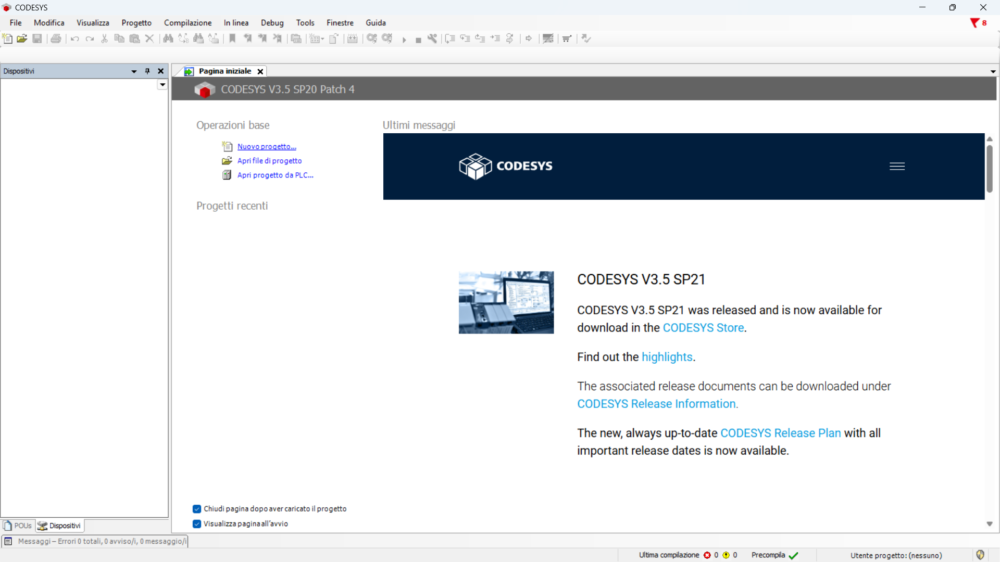

Crea un nuovo progetto e scegli `Progetto standard`.

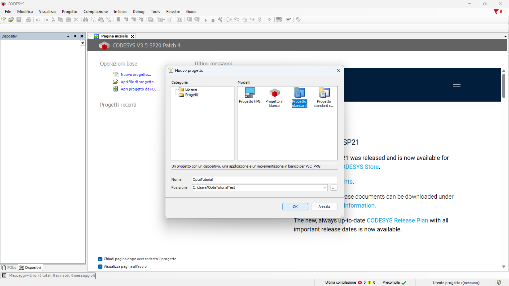

Assicurati che il dispositivo sia `Finder Opta`, poi seleziona il linguaggio del
programma.

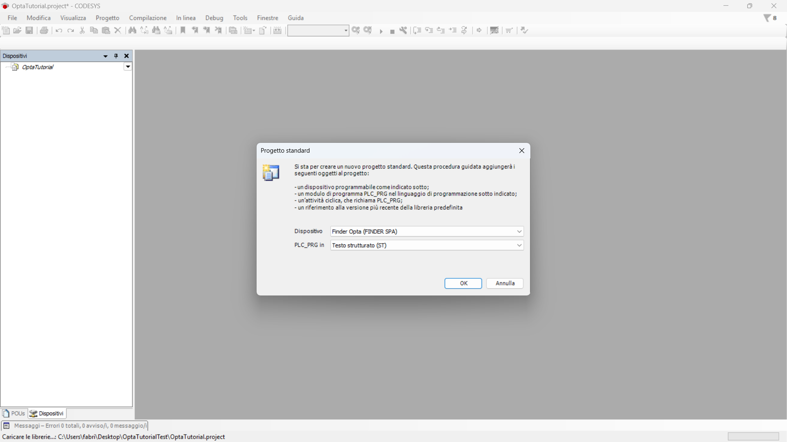

### Identificazione Finder OPTA via Ethernet

Fai doppio click sulla voce `Device (Finder Opta)` del menu `Dispositivi`, si
aprirà una scheda come mostrato qui sotto.

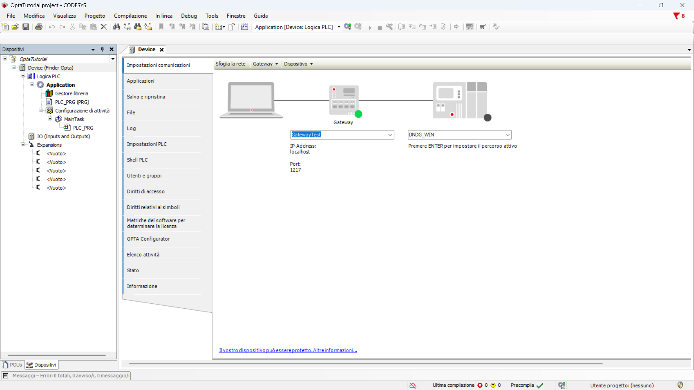

Premi il bottone `Sfoglia la rete` e assicurati di vedere il dispositivo Finder
OPTA comparire sotto il Gateway, poi premi `OK`. Se entrambi i Finder OPTA sono
già collegati alla rete, fai attenzione a selezionare quello che vuoi
configurare come client.

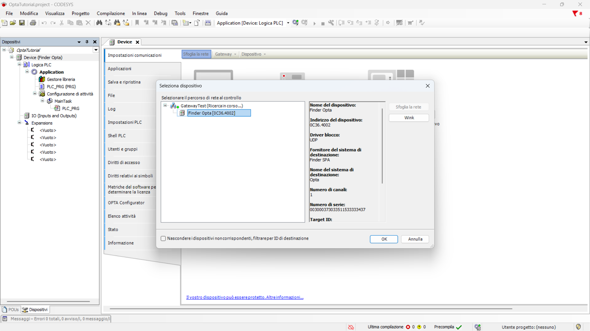

### Configurazione della porta Ethernet

In questa sezione configuriamo la porta Ethernet del Finder OPTA che si
comporta da client, ovvero la porta utilizzata per raggiungere il server Modbus
TCP.

Iniziamo aggiungendo l'adattatore Ethernet: premi il tasto destro sulla voce
`Device (Finder OPTA)` e scegli `Aggiungi dispositivo...`.

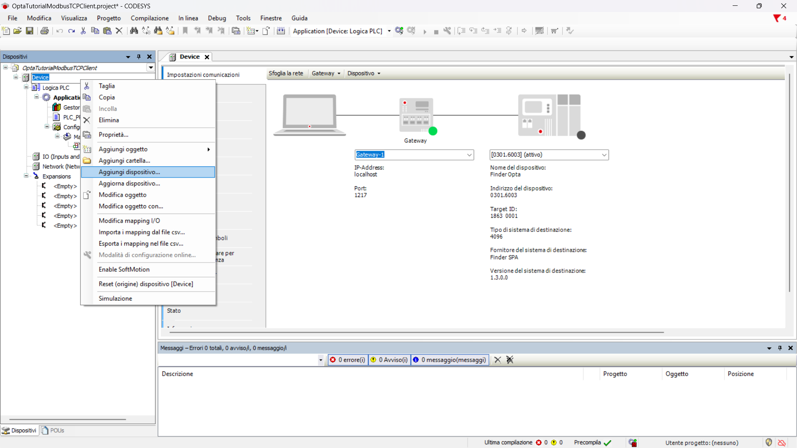

Dal menu, espandi la voce `Adattatore Ethernet`, seleziona `Ethernet` e clicca
su `Aggiungi dispositivo`.

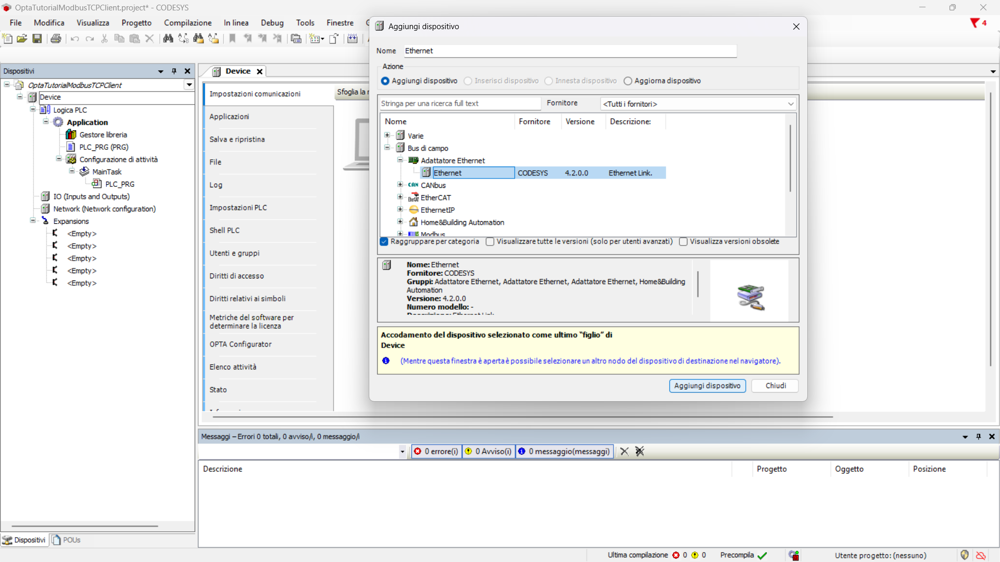

Adesso clicca due volte sulla voce `Ethernet (Ethernet)` nel menu laterale.

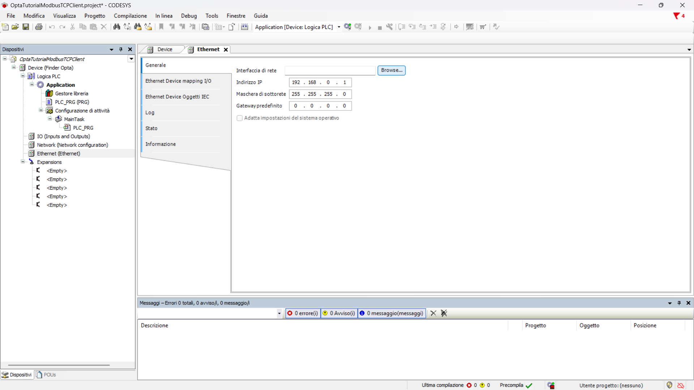

A questo punto leggi da Finder OPTA la sua configurazione di rete: cliccando
sul pulsante `Browse...` appare una finestra con i parametri di rete del
dispositivo collegato. Assicurati che i valori siano quelli del Finder OPTA che
si comporta da client:

- Indirizzo IP: `10.0.0.3`
- Maschera di sottorete: `255.255.255.0`
- Gateway predefinito: `10.0.0.1`

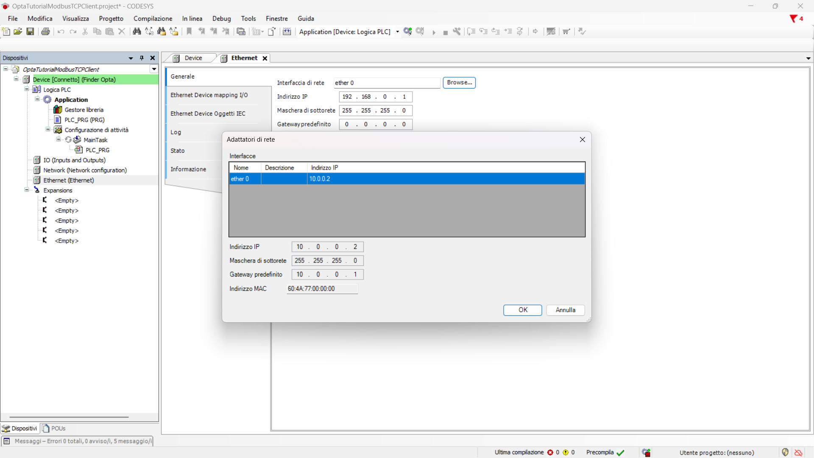

Premi `OK` per mantenere i parametri di rete di Finder OPTA. Prima di
proseguire ricordati di spuntare l'opzione `Adatta impostazioni del sistema
operativo` e successivamente clicca su `Yes` per confermare la modifica.

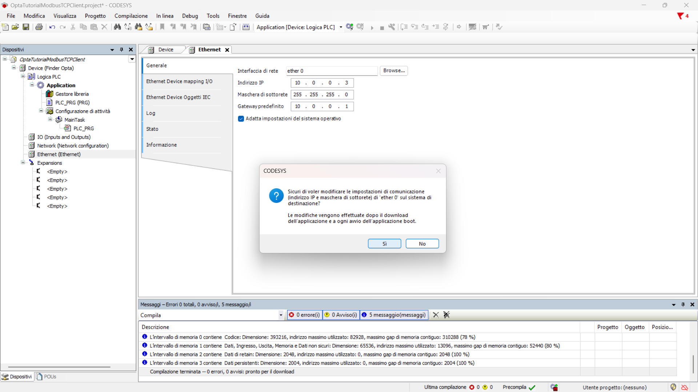

I parametri di rete sono adesso impostati nel progetto CODESYS, ma non sono
ancora salvati sul dispositivo: per salvarli su Finder OPTA è necessario
scaricare il programma sul dispositivo. Premi il pulsante verde in alto
etichettato come `Login` e conferma lo scaricamento.

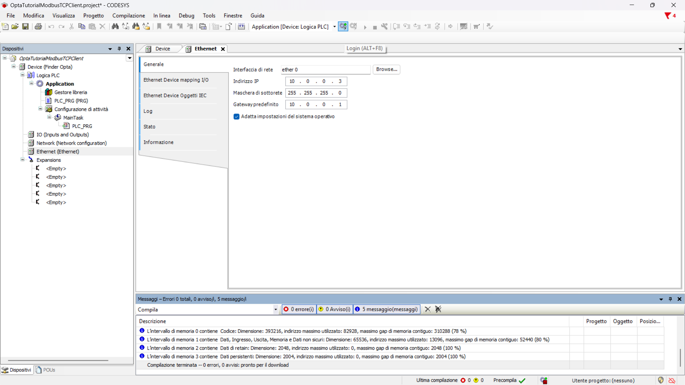

Durante questo passaggio CODESYS potrebbe restituire un errore come quello
mostrato qui sotto. Questo accade perché Finder OPTA ha appena cambiato il
proprio indirizzo IP, quindi il progetto punta ancora a quello precedente. In
questo caso è sufficiente ripetere la ricerca in rete vista nei primi passaggi -
clicca due volte sulla voce `Device (Finder Opta)`, premi `Sfoglia la rete` e
seleziona il Finder OPTA - per allineare il progetto al nuovo indirizzo IP del
dispositivo, poi premi di nuovo `Login`.

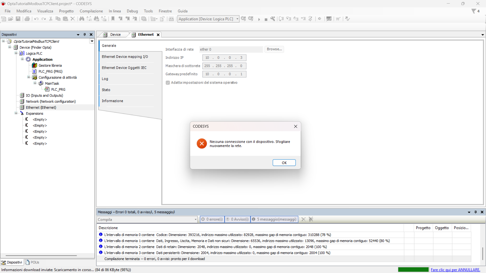

### Preparazione del programma ST

Apri `PLC_PRG`. Nell'area delle dichiarazioni inserisci:

```st
PROGRAM PLC_PRG
VAR
    inputCoil_0 : BOOL := FALSE;
    inputCoil_1 : BOOL := FALSE;
    inputCoil_2 : BOOL := FALSE;
    inputCoil_3 : BOOL := FALSE;
    led_1 : BOOL := FALSE;
    led_2 : BOOL := FALSE;
    led_3 : BOOL := FALSE;
    led_4 : BOOL := FALSE;
    outputCoil_0 : BOOL := FALSE;
    outputCoil_1 : BOOL := FALSE;
    outputCoil_2 : BOOL := FALSE;
    outputCoil_3 : BOOL := FALSE;
END_VAR
```

Nell'area dell'implementazione inserisci:

```st
led_1 := inputCoil_0;
led_2 := inputCoil_1;
led_3 := inputCoil_2;
led_4 := inputCoil_3;

outputCoil_0 := inputCoil_0;
outputCoil_1 := inputCoil_1;
outputCoil_2 := inputCoil_2;
outputCoil_3 := inputCoil_3;
```

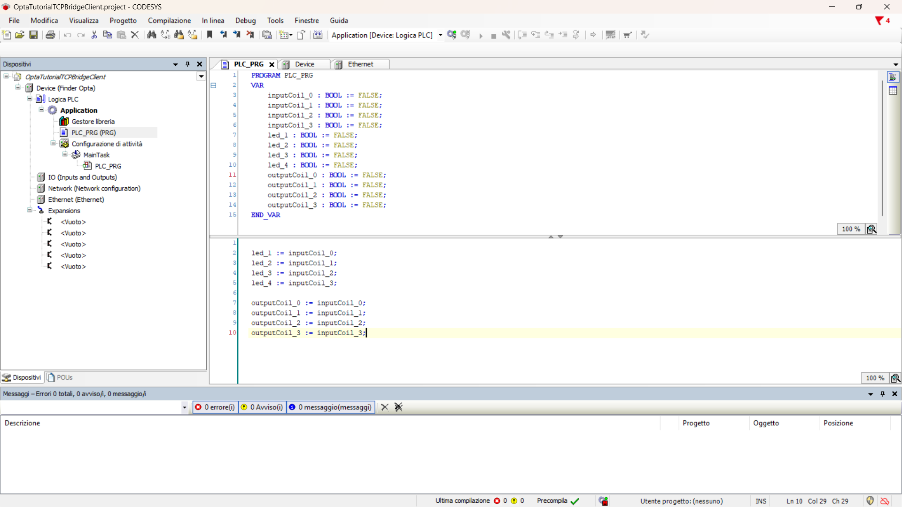

Le variabili `inputCoil` ricevono i comandi dal server Modbus locale.
Le variabili `led_` controllano i LED fisici, mentre le variabili `outputCoil`
forniranno i valori ai canali del client che aggiungeremo nella fase successiva.

### Aggiunta del server Modbus TCP locale

Premi il tasto destro su `Ethernet`, seleziona `Aggiungi dispositivo...`,
poi espandi `Modbus` > `ModbusTCP Slave Device` e aggiungi
`ModbusTCP Server Device`. Questo è il server locale che riceve le richieste
indirizzate a Opta A.

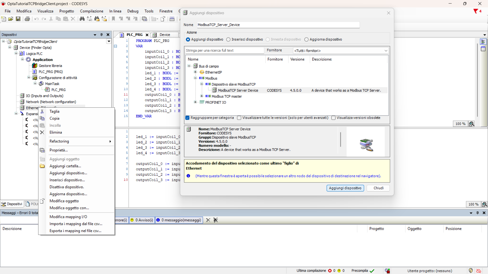

Apri la scheda `Configurazione Modbus TCP` e configura:

- Porta del server: `502`.
- Discrete Bit Areas: abilitato.
- Coil (numero di coil): `4`, oppure il numero minimo supportato che includa
  quattro coil.
- Coil (indirizzo iniziale): `0`.
- Holding Register e Input Register: mantieni il numero minimo supportato;
  in questo esempio non vengono utilizzati.
- Watchdog: disabilitato per questa dimostrazione.

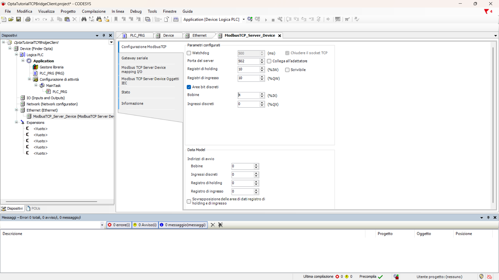

### Mappatura delle coil ricevute e dei LED

Apri `Modbus TCP Server Device I/O Mapping` ed espandi l'area delle coil.

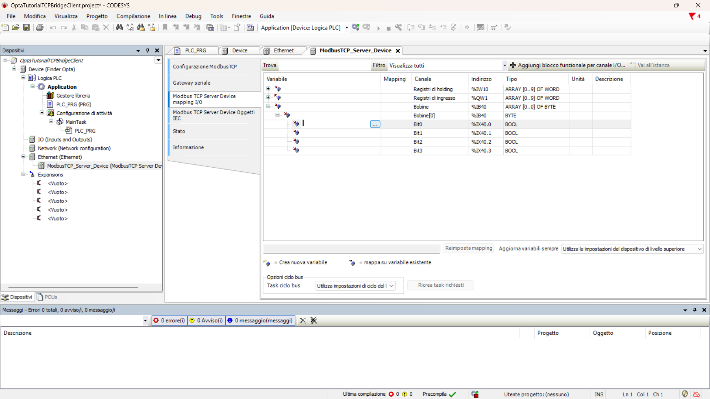

Fai doppio click sulla cella `Variabile` della prima coil e utilizza il pulsante
delle opzioni per selezionare `inputCoil_0` sotto `Application` > `PLC_PRG`,
poi premi `OK`.

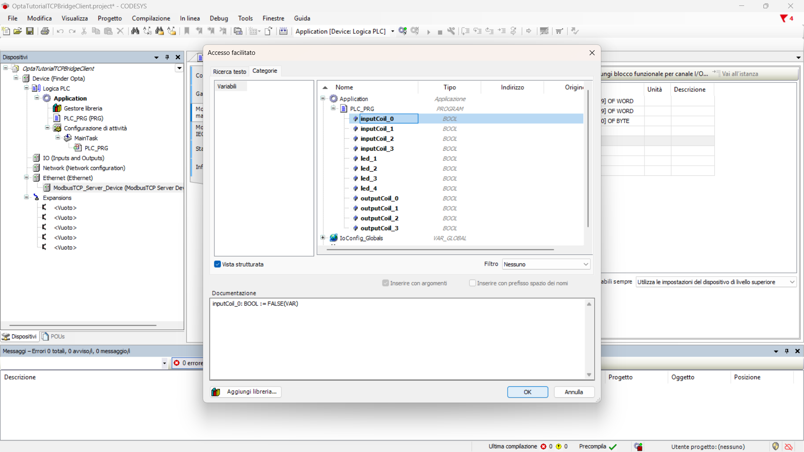

Ripeti l'operazione per le altre coil fino a ottenere questa mappatura:

- Coil all'indirizzo `0`: `PLC_PRG.inputCoil_0`.
- Coil all'indirizzo `1`: `PLC_PRG.inputCoil_1`.
- Coil all'indirizzo `2`: `PLC_PRG.inputCoil_2`.
- Coil all'indirizzo `3`: `PLC_PRG.inputCoil_3`.

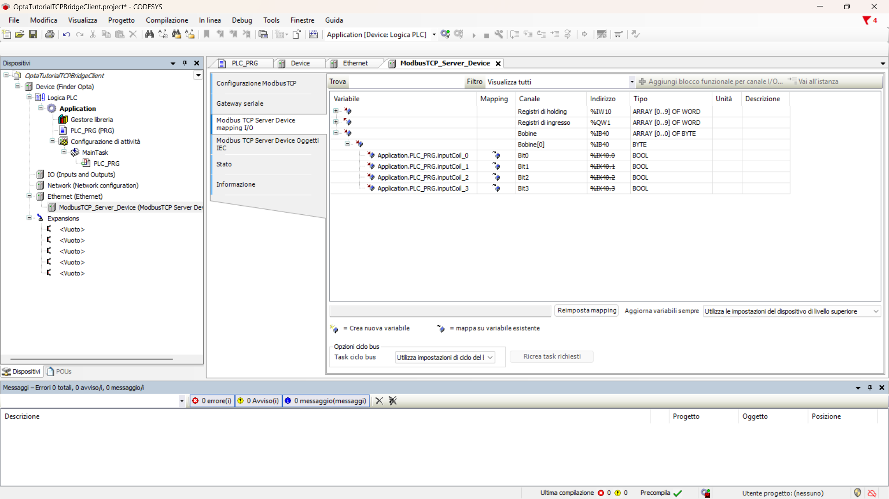

Adesso apri `I/O` > `Opta I/O Mapping` e individua le uscite dei LED.

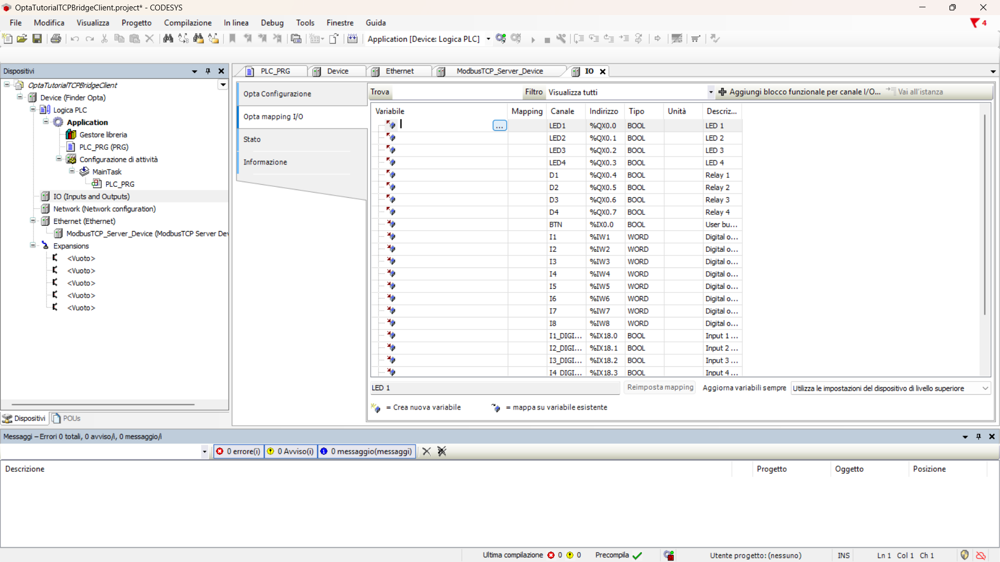

Utilizza il selettore delle variabili per assegnare ciascuna uscita LED:

- LED 1: `PLC_PRG.led_1`.
- LED 2: `PLC_PRG.led_2`.
- LED 3: `PLC_PRG.led_3`.
- LED 4: `PLC_PRG.led_4`.

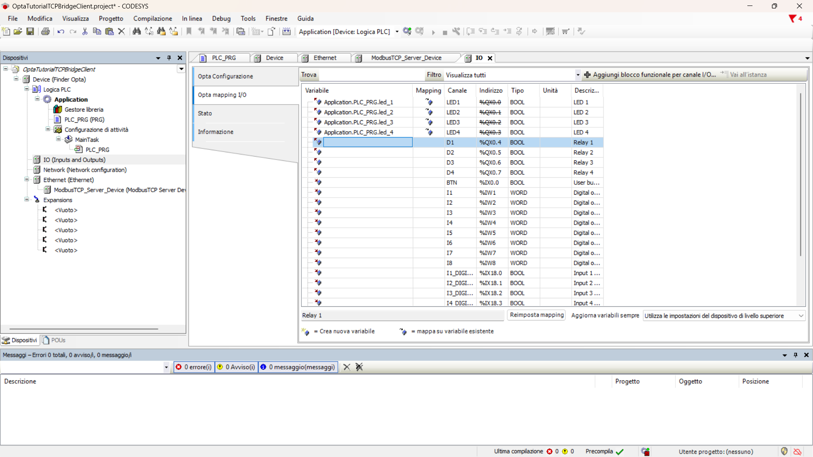

### Verifica di Opta A con mbpoll

Premi `Login` per scaricare il progetto, poi `Start` per eseguirlo.

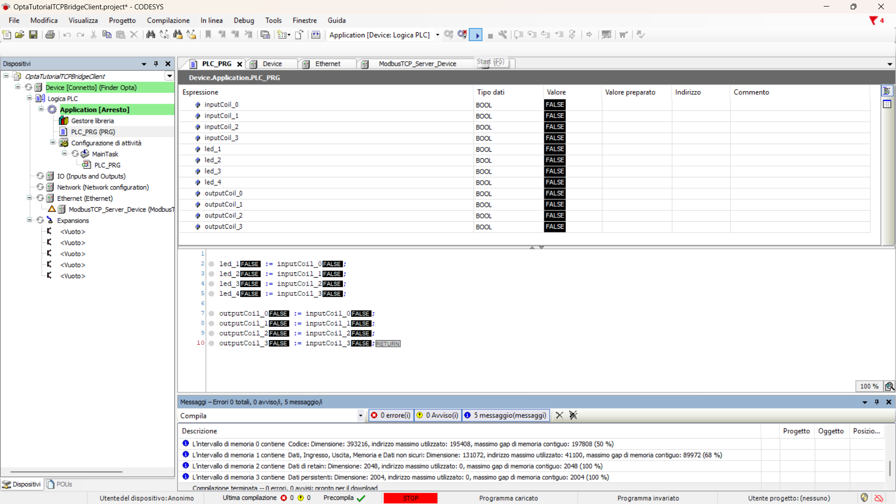

Da un terminale sul PC, prova prima a leggere la coil all'indirizzo `0` con
il seguente comando:

```sh
mbpoll -m tcp -t 0 -0 -r 0 -1 10.0.0.3
```


Poi scrivi ON nella coil all'indirizzo `0`:

```sh
mbpoll -m tcp -t 0 -0 -r 0 -1 10.0.0.3 1
```


Il LED 1 di Opta A dovrebbe accendersi.

In CODESYS verifica che le variabili `coil`, `led` e `outputCoil` seguano
i comandi. Completa questa prova prima di aggiungere la configurazione del client.

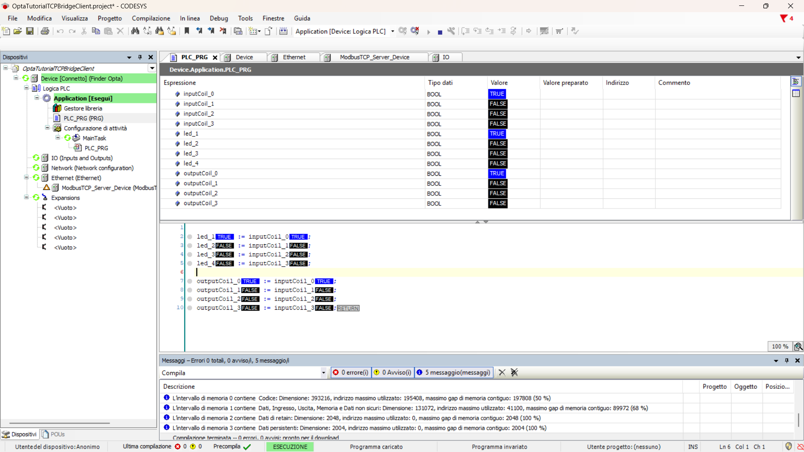

Scrivi OFF nella stessa coil:

```sh
mbpoll -m tcp -t 0 -0 -r 0 -1 10.0.0.3 0
```

Il LED 1 di Opta A dovrebbe spegnersi.

Nel comando mbpoll:

- `-m tcp` seleziona Modbus TCP.
- `-t 0` seleziona le coil.
- `-0` seleziona gli indirizzi a partire da zero.
- `-r` seleziona l'indirizzo iniziale.
- `-1` limita la lettura a una sola esecuzione.
- `10.0.0.3` è l'indirizzo IP di Opta A.
- `0` o `1` è il valore da scrivere nella coil.

Consulta la [documentazione dei comandi mbpoll](https://github.com/epsilonrt/mbpoll/blob/master/doc/mbpoll.1).

## Configurazione del client di Opta A

Salva il progetto ed esegui il logout per aggiungere il client. Mantieni il
server locale nel progetto: Opta A ha bisogno di entrambi i ruoli sulla stessa
interfaccia Ethernet.

### Aggiunta del client e del server remoto

Premi il tasto destro su `Ethernet`, seleziona `Aggiungi dispositivo...`
e aggiungi `Modbus TCP Client` dalla categoria `Modbus`.

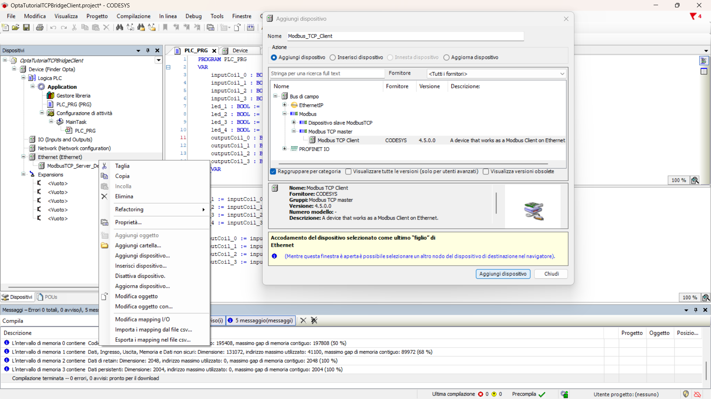

Apri il client e mantieni un `Response timeout` di `1000` ms per questo esempio.

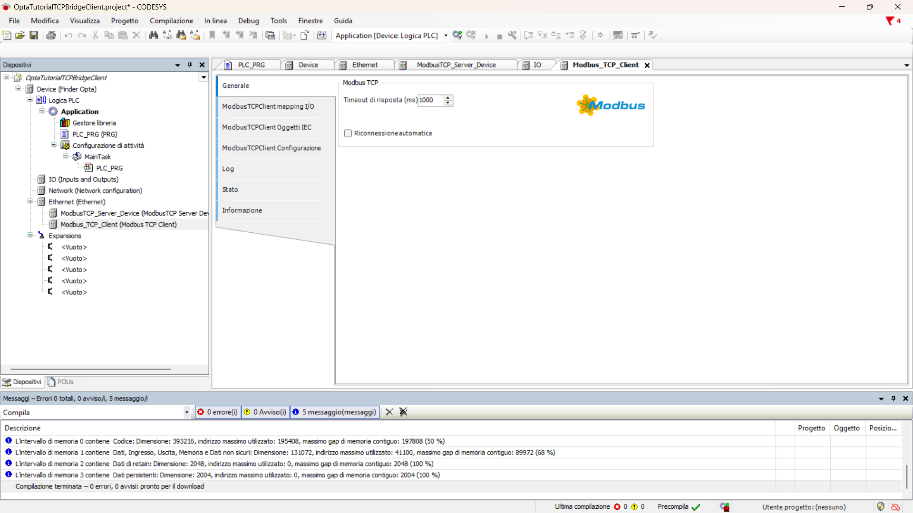

Premi il tasto destro su `Modbus_TCP_Client (Modbus TCP Client)`, seleziona
`Aggiungi dispositivo...` e aggiungi `Modbus TCP Server`. Questo nodo figlio
descrive il dispositivo remoto Opta B; il server locale in ascolto rimane il
nodo separato `ModbusTCP Server Device`.

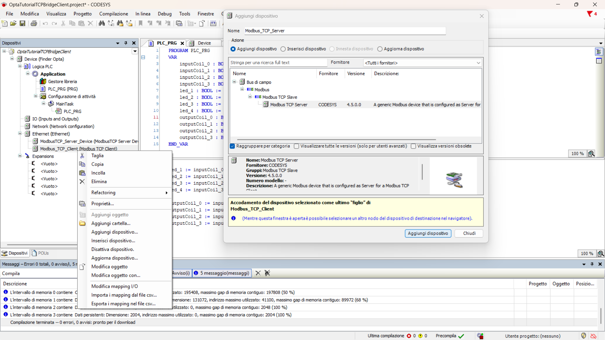

Apri il nuovo nodo del server remoto e configura:

- Server IP address: `10.0.0.2`
- Response timeout: `1000` ms
- Port: `502`

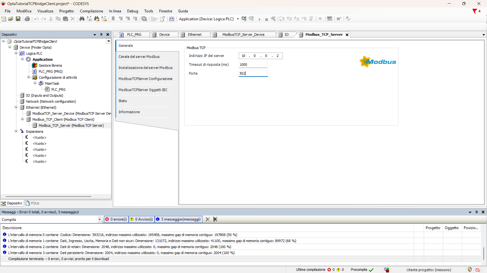

### Aggiunta di quattro canali Write Single Coil

Nel nodo del server remoto, apri `Canale del server Modbus` e clicca su
`Aggiungi canale`.

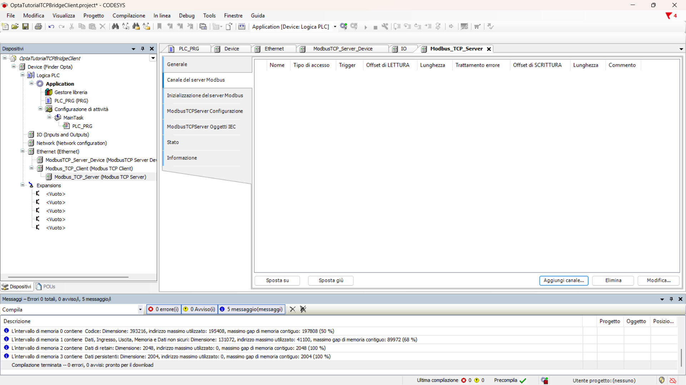

Configura il primo canale come segue:

- Nome: `Channel 0`.
- Tipo di accesso: `Write Single Coil (Codice funzione 5)`.
- Offset del registro di scrittura: `0x0000`.
- Trigger: `Ciclico`.
- Tempo di ciclo: `100` ms.

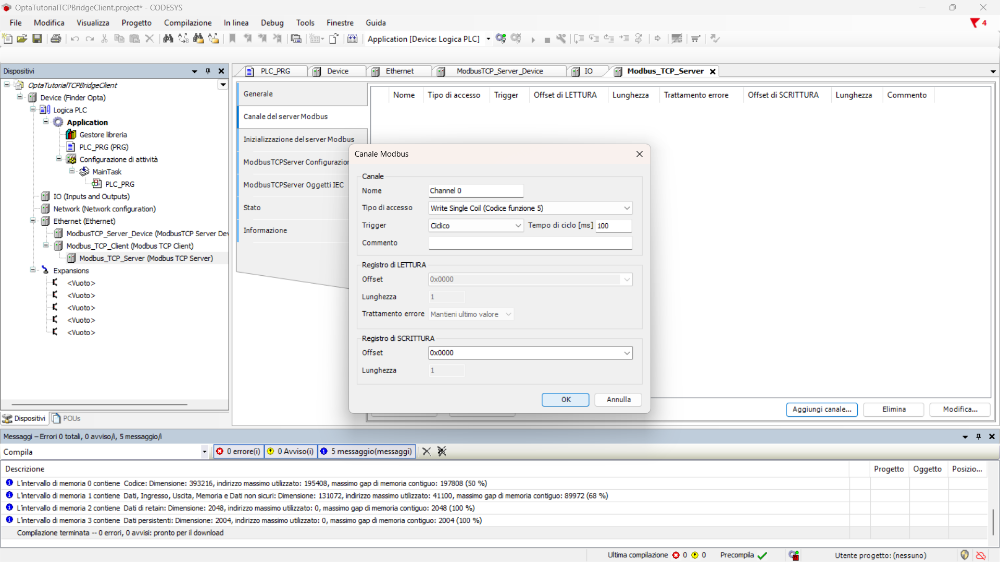

Premi `OK`, poi aggiungi gli altri tre canali con lo stesso tipo di accesso,
trigger e tempo di ciclo. Modifica il nome e l'offset di scrittura per ciascuno:

- `Channel 1`: offset di scrittura `1` / `0x0001`.
- `Channel 2`: offset di scrittura `2` / `0x0002`.
- `Channel 3`: offset di scrittura `3` / `0x0003`.

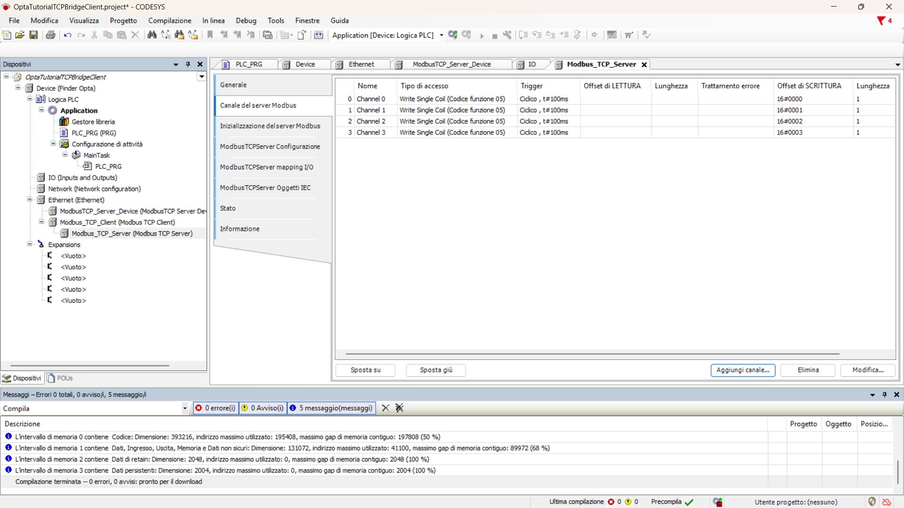

FC05 scrive una coil per richiesta. Se viene mostrata una lunghezza di
scrittura, il suo valore è `1`. Utilizza il campo dell'offset di **scrittura**.
Ogni canale invia periodicamente il proprio valore corrente, incluso `FALSE`,
quindi viene trasmesso anche lo spegnimento di un LED.

### Mappatura dei valori da trasmettere

Apri la scheda `ModbusTCPServer I/O Mapping` del server remoto.

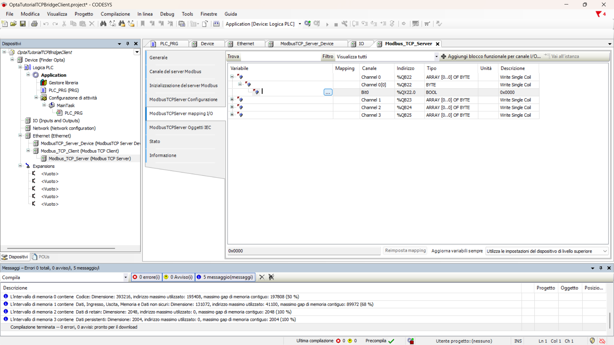

Fai doppio click sulla cella `Variabile` del valore booleano di uscita del primo
canale, utilizza il pulsante delle opzioni per selezionare `outputCoil_0`
sotto `Application` > `PLC_PRG` e premi `OK`.


Ripeti l'operazione per gli altri tre canali:

- `Channel 0`: `PLC_PRG.outputCoil_0`.
- `Channel 1`: `PLC_PRG.outputCoil_1`.
- `Channel 2`: `PLC_PRG.outputCoil_2`.
- `Channel 3`: `PLC_PRG.outputCoil_3`.

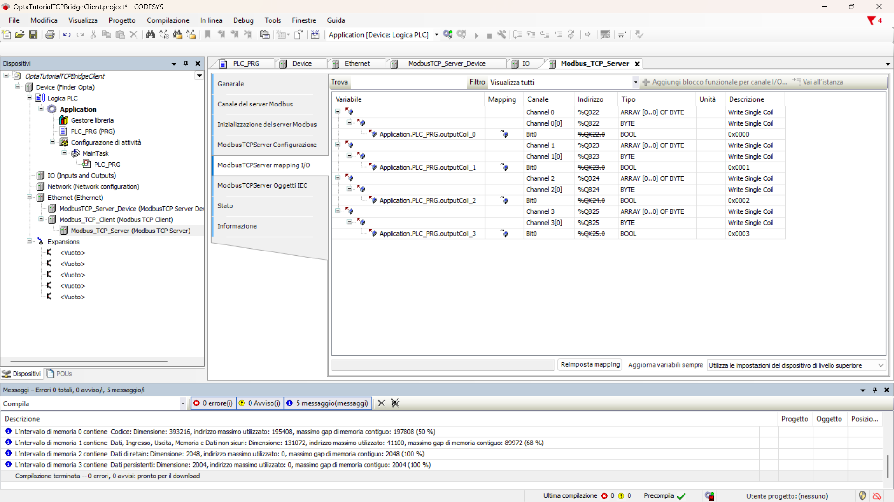

Non serve altra logica ST: le assegnazioni copiano già gli stati ricevuti in
queste variabili di uscita. Salva il progetto. La comunicazione con Opta B può
segnalare errori finché il suo server non è configurato e in esecuzione.

## Adattamento di Opta B dal tutorial sul server

Crea un nuovo progetto CODESYS seguendo il tutorial sul server
Modbus TCP <!-- TODO: Aggiungere il link pubblico al tutorial italiano sul server Modbus TCP quando disponibile. -->, fino alla
sezione sullo scaricamento del programma su Finder OPTA compresa. Otterrai
così un progetto server Modbus TCP funzionante da utilizzare come punto di
partenza per Opta B in questo tutorial. Puoi saltare le sezioni sugli HMI.
Nei prossimi passaggi adatteremo l'esempio del contatore per controllare i
quattro LED tramite le coil.

### Configurazione della rete e del server

Seleziona Opta B con `Sfoglia la rete`. La sua configurazione Ethernet deve
utilizzare l'indirizzo IP `10.0.0.2` e la maschera di sottorete
`255.255.255.0`, in accordo con il nodo del server remoto nel progetto di Opta A.

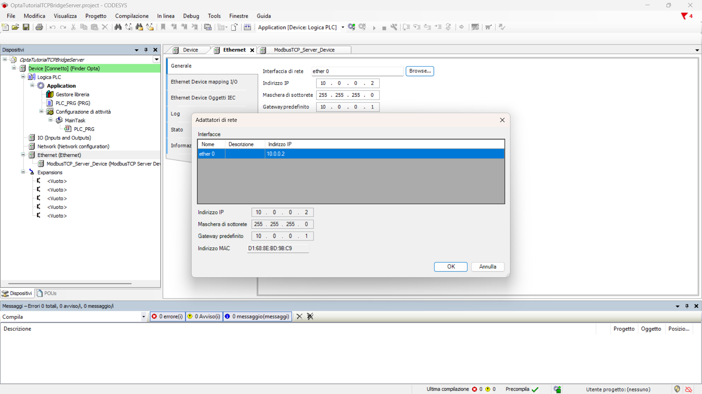

Nel suo `ModbusTCP Server Device` esistente, mantieni la porta `502`, abilita
`Discrete Bit Areas` e configura almeno quattro coil.

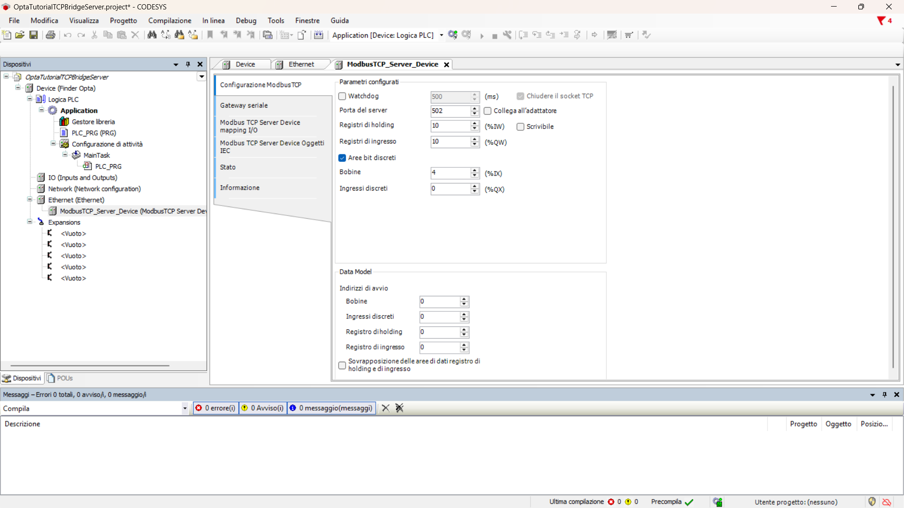

Il tutorial precedente imposta l'indirizzo iniziale dei registri a `1`.
Quelli sono indirizzi dei registri: per questo esempio imposta esplicitamente
l'indirizzo iniziale delle **coil** a `0`. I quattro offset di scrittura di
Opta A devono corrispondere a quest'area coil.

### Sostituzione del programma contatore e mappatura dei LED

Rimuovi la precedente mappatura dell'Input Register `mbCount` prima di sostituire
il programma contatore. Nell'area delle dichiarazioni di `PLC_PRG` inserisci:

```st
PROGRAM PLC_PRG
VAR
    inputCoil_0 : BOOL := FALSE;
    inputCoil_1 : BOOL := FALSE;
    inputCoil_2 : BOOL := FALSE;
    inputCoil_3 : BOOL := FALSE;
    led_1 : BOOL := FALSE;
    led_2 : BOOL := FALSE;
    led_3 : BOOL := FALSE;
    led_4 : BOOL := FALSE;
END_VAR
```

Nell'area dell'implementazione inserisci:

```st
led_1 := inputCoil_0;
led_2 := inputCoil_1;
led_3 := inputCoil_2;
led_4 := inputCoil_3;
```

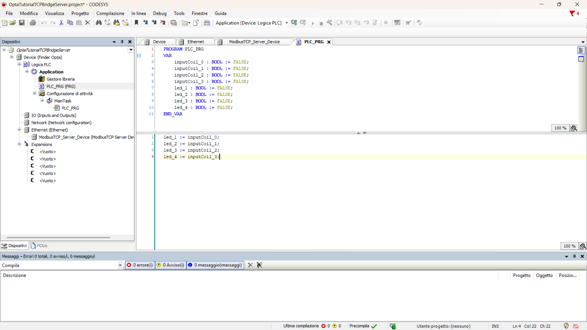

Apri `Modbus TCP Server Device I/O Mapping` ed espandi l'area delle coil per
mostrare i bit delle coil in ingresso. Fai doppio click sulla cella `Variabile`
della prima coil per far comparire il pulsante delle opzioni.

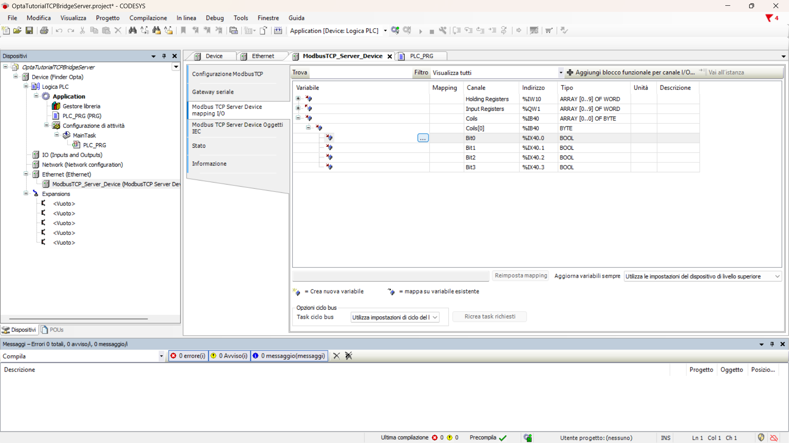

Clicca sul pulsante delle opzioni, espandi `Application` e poi `PLC_PRG`,
seleziona `inputCoil_0` e premi `OK`.

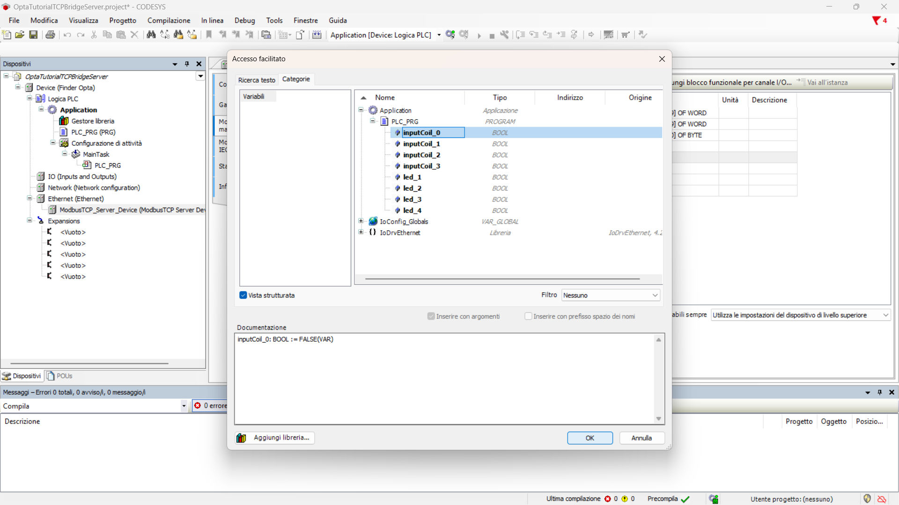

Ripeti l'operazione per le coil rimanenti fino a ottenere questa mappatura:

- Coil all'indirizzo `0`: `PLC_PRG.inputCoil_0`.
- Coil all'indirizzo `1`: `PLC_PRG.inputCoil_1`.
- Coil all'indirizzo `2`: `PLC_PRG.inputCoil_2`.
- Coil all'indirizzo `3`: `PLC_PRG.inputCoil_3`.


Adesso apri `I/O` > `Opta I/O Mapping` e individua le uscite dei LED.
Fai doppio click sulla cella `Variabile` del LED 1 per far comparire il
pulsante delle opzioni.

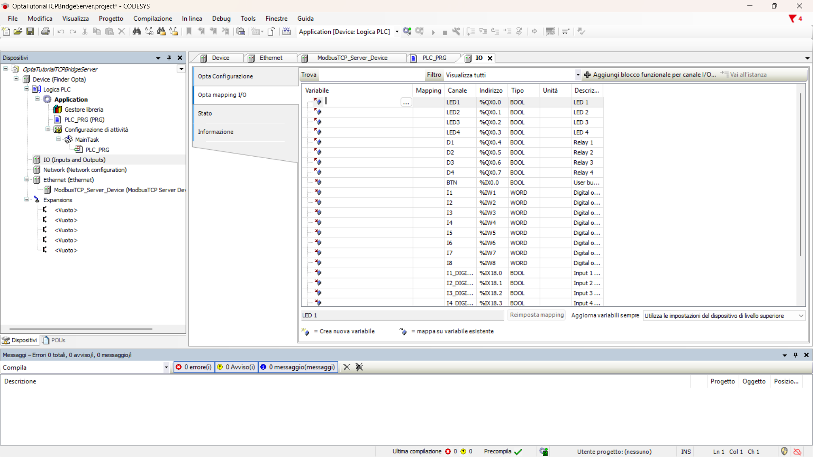

Clicca sul pulsante delle opzioni, espandi `Application` e poi `PLC_PRG`,
seleziona `led_1` e premi `OK`.

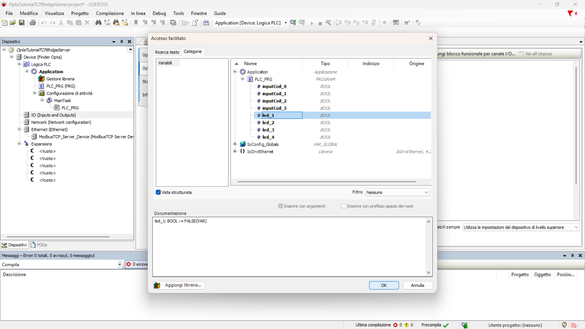

Ripeti l'operazione per gli altri LED fino ad assegnare a ogni uscita la
variabile corrispondente:

- LED 1: `PLC_PRG.led_1`.
- LED 2: `PLC_PRG.led_2`.
- LED 3: `PLC_PRG.led_3`.
- LED 4: `PLC_PRG.led_4`.

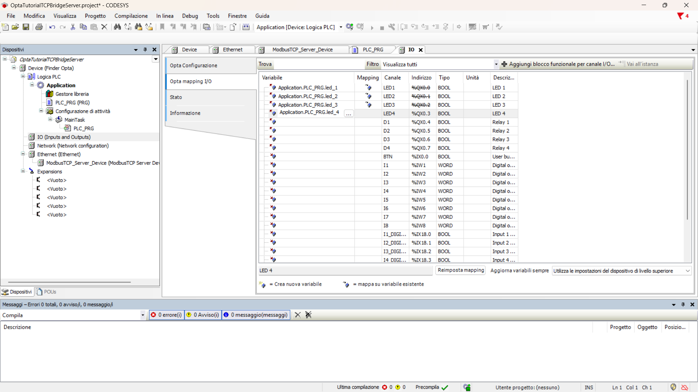

Opta B non ha bisogno di un client Modbus TCP né di un timer: il suo server
riceve le scritture e il task PLC applica i valori ai LED.

### Scaricamento e verifica di Opta B

Scarica il progetto di Opta B con `Login` e avvialo con `Start`.

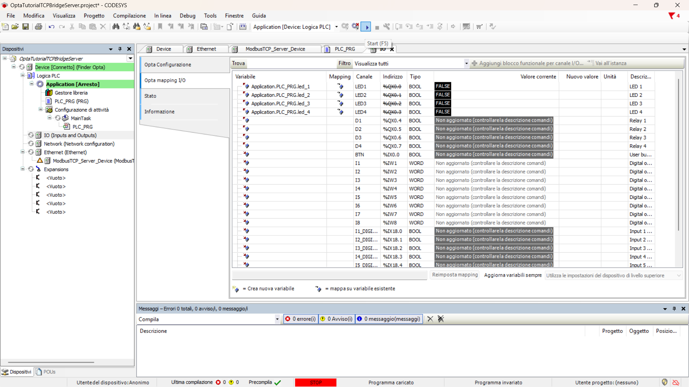

Prima di avviare il bridge completo, prova Opta B direttamente dal PC come
fatto in precedenza con Opta A:

```sh
mbpoll -m tcp -t 0 -0 -r 0 -1 10.0.0.2 1
```

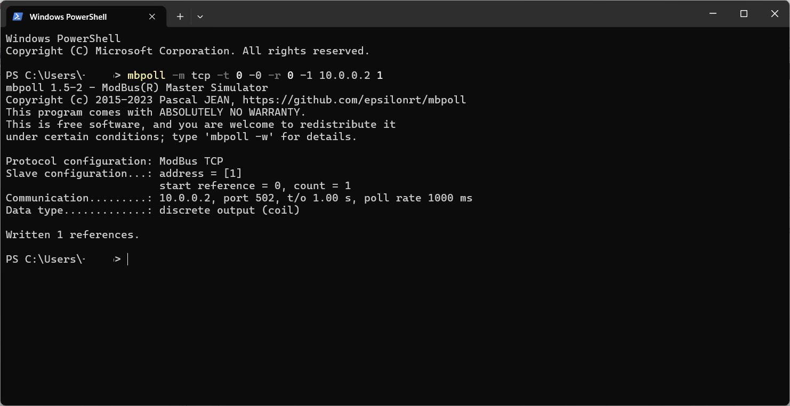

Il LED 1 dovrebbe accendersi e la lettura dovrebbe riportare `1` per la coil `0`.

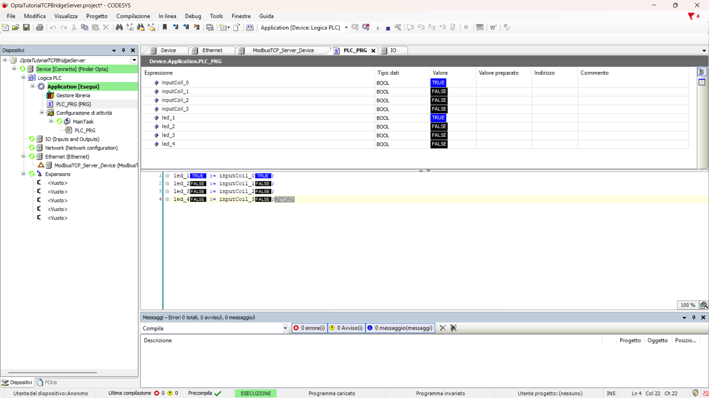

Ripeti con gli indirizzi `1`, `2` e `3`.

Salva ed esegui `Logout` da Opta B senza premere `Stop`, in modo che la sua
applicazione rimanga in esecuzione mentre torni al progetto di Opta A.

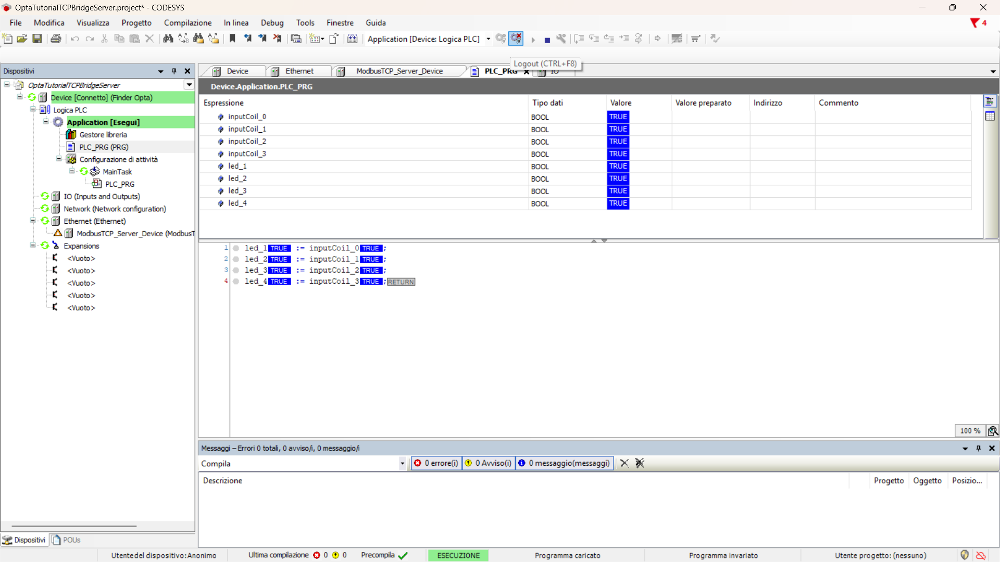

## Prova del bridge completo

Apri il progetto di Opta A, verifica che il dispositivo selezionato sia
`10.0.0.3`, scarica la configurazione aggiornata con `Login` e premi `Start`.
Entrambe le applicazioni devono ora essere in esecuzione.

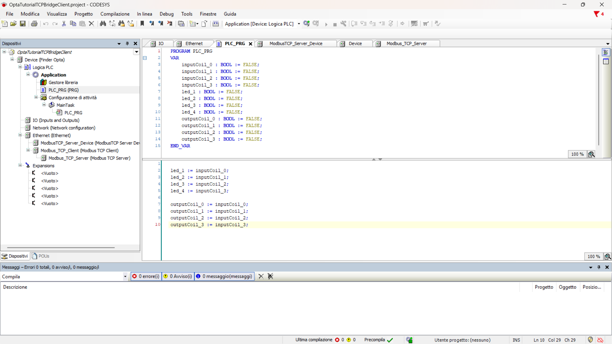

Invia questi comandi **solo a Opta A**, leggendo entrambi i dispositivi dopo
ogni scrittura:

- Accendi il LED 1:
  `mbpoll -m tcp -t 0 -0 -r 0 -1 10.0.0.3 1`.
- Accendi il LED 2:
  `mbpoll -m tcp -t 0 -0 -r 1 -1 10.0.0.3 1`.
- Accendi il LED 3:
  `mbpoll -m tcp -t 0 -0 -r 2 -1 10.0.0.3 1`.
- Accendi il LED 4:
  `mbpoll -m tcp -t 0 -0 -r 3 -1 10.0.0.3 1`.
- Ripeti ogni comando con il valore finale `0` per spegnere il LED corrispondente.

Leggi gli stati delle coil su entrambi i dispositivi:

```sh
mbpoll -m tcp -t 0 -0 -r 0 -c 4 -1 10.0.0.3
mbpoll -m tcp -t 0 -0 -r 0 -c 4 -1 10.0.0.2
```

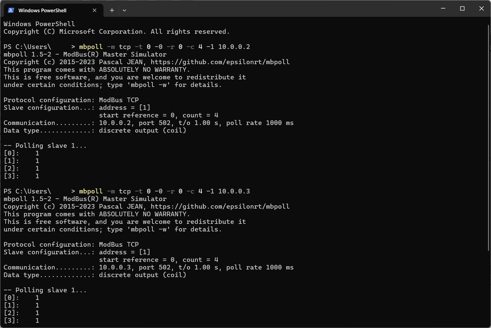

Adesso verifica i valori delle coil in CODESYS collegandoti a ciascun
dispositivo. Controlla che le variabili siano cambiate correttamente e che
corrispondano ai valori letti con `mbpoll`. Dovrebbero essere tutte impostate
a `TRUE`.

Valori su Finder Opta A.

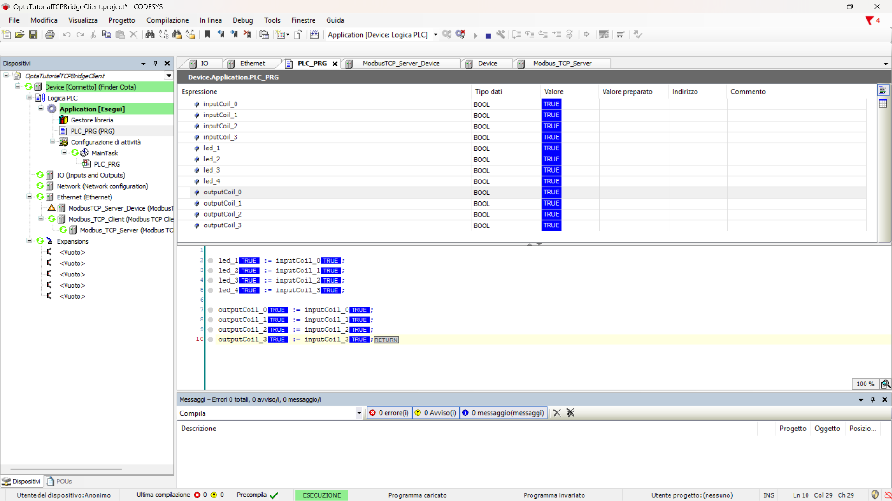

Valori su Finder Opta B.

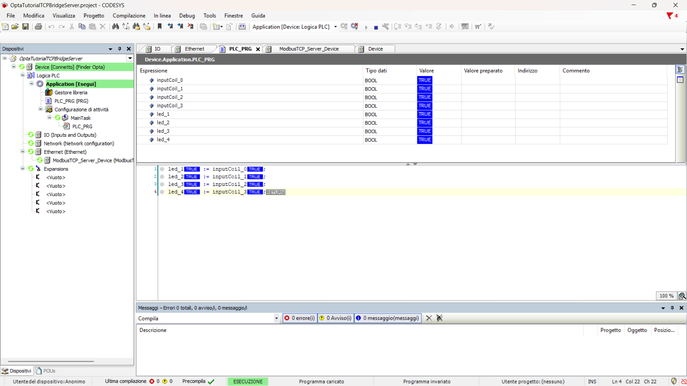

Verifica anche i LED fisici su entrambi i dispositivi: ogni coppia di LED
corrispondenti dovrebbe seguire lo stesso comando ON/OFF.

## Risoluzione dei problemi

Se i LED di Opta A rispondono ma quelli di Opta B no, verifica separatamente
i due passaggi della comunicazione:

- Se il PC non riesce a scrivere su un Opta, verifica gli indirizzi IP, la
  sottorete, la porta del server `502` e che l'applicazione sia in esecuzione.
- Se la scrittura riesce ma il LED locale non cambia stato, verifica la
  mappatura dei bit delle coil in ingresso, la mappatura delle uscite LED
  ed eventuali assegnazioni che sovrascrivono le variabili delle coil.
- Se i LED di Opta A funzionano ma i suoi valori da scrivere rimangono
  invariati, verifica le assegnazioni ST e le quattro mappature delle uscite
  del client.
- Se il client segnala un timeout o l'assenza di connessione, verifica l'IP
  remoto `10.0.0.2`, la porta, l'applicazione di Opta B e il collegamento Ethernet.

Per provare Opta B direttamente, ferma temporaneamente l'applicazione di
Opta A e ripeti la prova diretta con `mbpoll`. Se riesce, torna a Opta A e
controlla lo stato del server remoto, la diagnostica dei canali e i valori
correnti delle uscite online. Se necessario, limita la prova al primo canale FC05.

Verifica che ogni canale utilizzi il trigger `Ciclico` e che il valore da
scrivere sia mappato alla variabile `outputCoil` prevista.

## Conclusioni

Hai configurato Opta A per ricevere quattro comandi sulle coil da un PC,
controllare i propri LED e scrivere gli stessi stati su Opta B tramite quattro
canali ciclici FC05. Opta B riceve queste scritture tramite il proprio server
e le applica ai suoi LED.
