# How to Configure a Modbus TCP Bridge with Finder OPTA in CODESYS

Learn how to configure Finder OPTA as both a Modbus TCP server and
client in CODESYS, receiving coil commands from a PC and sending their
values to a second Finder OPTA so that the four LEDs on both devices
follow the same commands.

## Overview

In this tutorial we use two Finder OPTA devices and a PC running
`mbpoll`. **Opta A** is the bridge: its Modbus
TCP server receives commands from the PC, and its Modbus TCP client
writes the resulting states to **Opta B**, which acts as a
Modbus TCP server. Each device uses four coils to control its four
LEDs.

We will first configure the server side of Opta A and verify with
`mbpoll` that each coil controls its local LED. Next, we will
add the client side of Opta A, using four cyclic Write Single Coil
channels. Finally, we will adapt the Opta B project from the existing [Modbus TCP
server tutorial](../CodesysOptaModbusTCPServerTutorial/content.md) and test the complete bridge.

The client configuration follows the approach of the [Modbus TCP
client tutorial](../CodesysOptaModbusTCPClientTutorial/content.md), but here the client writes coils instead of reading
an Input Register.

## Goals

- Configure Opta A as both a Modbus TCP server and client.
- Receive four coil commands from `mbpoll` and control the
  LEDs of Opta A.
- Configure four cyclic FC05 channels to send those states to Opta
  B.
- Adapt the existing server project so that Opta B controls its LEDs
  from coils.
- Verify each communication step and diagnose mapping or connection
  problems.

## Requirements

Before starting, make sure you have:

- [Finder OPTA CODESYS
  PLC](https://opta.findernet.com/en/codesys) (x2).
- Suitable switching power supplies for both Finder OPTA devices.
- Ethernet cables (x3) and a switch or router connecting both devices
  and your PC.
- CODESYS with the OPTA Configurator plug-in installed, as described
  in the [installation
  guide](https://opta.findernet.com/en/tutorial/codesys-plugin-tutorial).
- Ethernet communication configured, as described in the [Ethernet
  guide](https://opta.findernet.com/en/tutorial/codesys-via-ethernet).
- [mbpoll](https://github.com/epsilonrt/mbpoll) installed
  on your PC.
- The CODESYS project created in the [Modbus TCP
  server tutorial](../CodesysOptaModbusTCPServerTutorial/content.md), to use as the starting point for Opta B.

Use the following network configuration, consistent with the client
tutorial:

- PC: `10.0.0.1`, sends commands with
  `mbpoll`.
- Opta A: `10.0.0.3`, acts as both server and client.
- Opta B: `10.0.0.2`, acts as server.
- Subnet mask: `255.255.255.0` on all three devices.

Both servers listen on TCP port `502`. All devices
communicate within the same subnet; a gateway is only needed to reach
other networks. Keep the gateway setting appropriate for your
network.

If both Finder OPTA devices still have the factory address
`10.0.0.2`, connect them one at a time and change Opta A to
`10.0.0.3` before connecting them together. Follow the [IP
address configuration guide](https://opta.findernet.com/en/tutorial/change-ip-codesys) if necessary.

## Understanding coils and the bridge

A coil is a single-bit Modbus value that a client can read and write:
`1` means ON and `0` means OFF. In this tutorial, we use four coils to
control the four LEDs on each Finder OPTA.

Modbus uses function codes to specify the operation requested by a client:

- FC01 (Read Coils): reads the state of one or more coils.
- FC05 (Write Single Coil): writes the state of one coil.
- FC15 (Write Multiple Coils): writes the states of multiple coils.

The bridge uses four FC05 channels to send the coil states from Opta A to
Opta B, one coil per channel.

Each coil has an address. We use addresses `0`, `1`, `2`, and `3` for
LEDs 1, 2, 3, and 4 on both devices.

The PC sends commands to Opta A, which updates its LEDs and forwards the
same values to Opta B. This makes the LEDs on both devices follow the
same ON/OFF commands.

## Configuring Opta A to receive commands

In this first stage, Opta B can remain disconnected. The result to
verify is that the PC can switch each LED of Opta A on and off through
its local server.

### Creating a CODESYS Project

Open CODESYS.

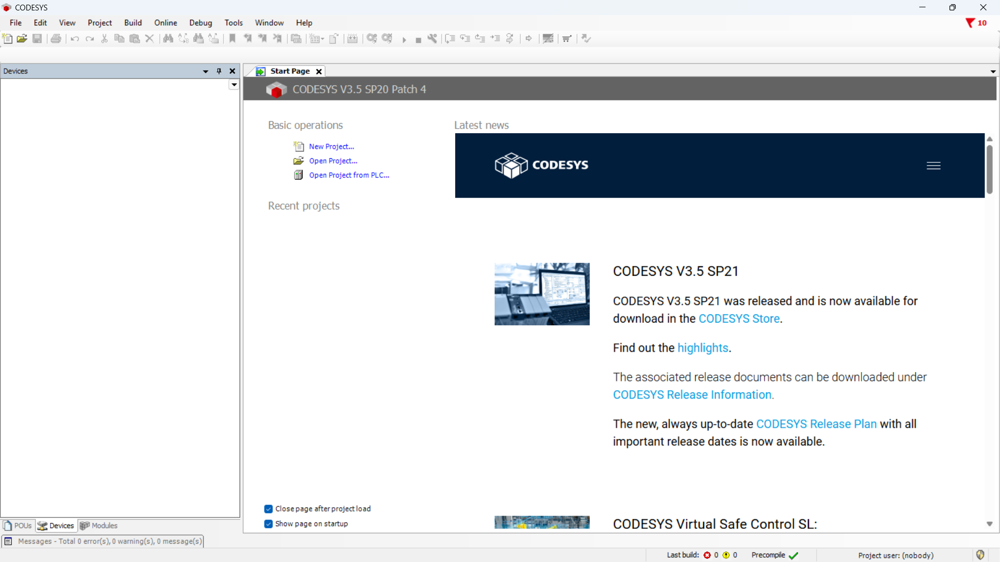

Create a new project and choose `Standard project`.

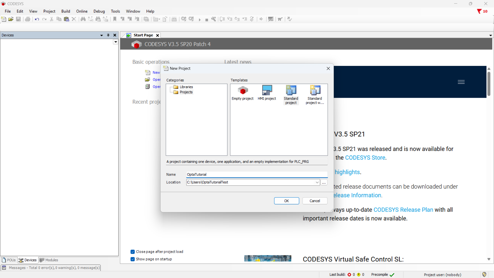

Make sure the device is `Finder Opta`, then select the program language.

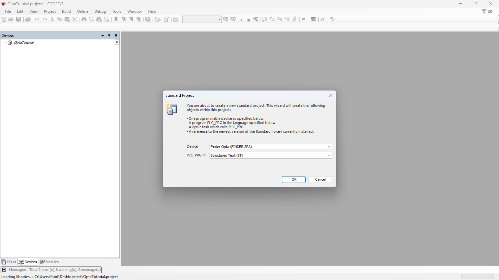

### Identifying Finder OPTA via Ethernet

Double-click the `Device (Finder Opta)` entry in the `Devices` menu. A tab will open as shown below.

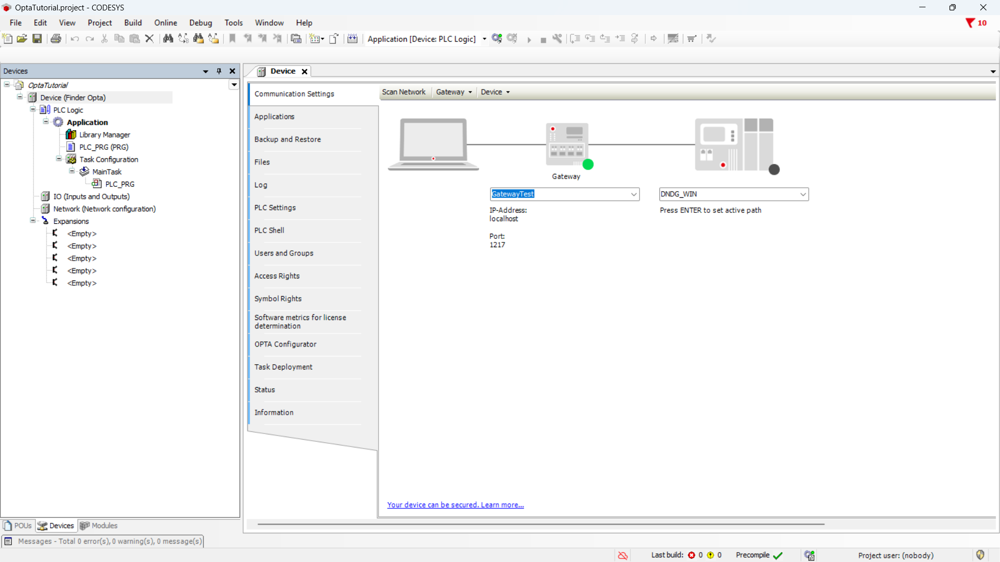

Click the `Scan network` button and make sure you see the Finder OPTA device appear under the Gateway, then press `OK`.

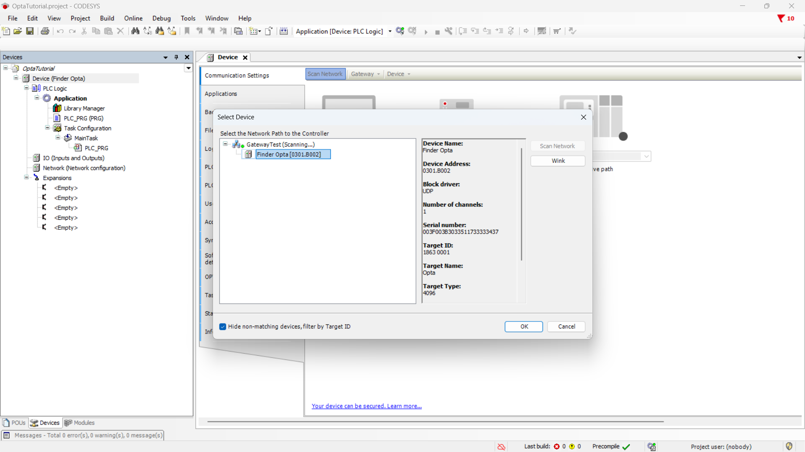

### Ethernet port configuration

In this section we will configure the Ethernet port of the Finder OPTA acting
as client, which is the port used to reach the Modbus TCP server.

Let's start by adding the Ethernet adapter: right-click on the
`Device (Finder OPTA)` item and choose `Add Device...`.

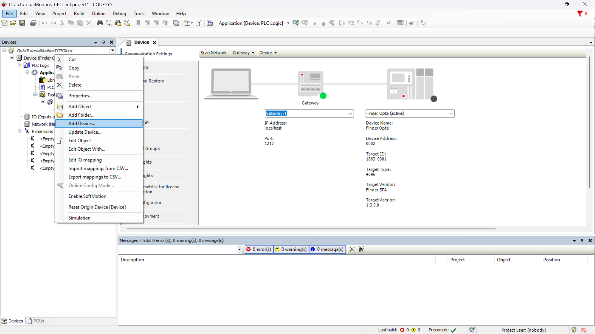

From the menu, expand the `Ethernet Adapter` item, select `Ethernet`, and click
`Add Device`.

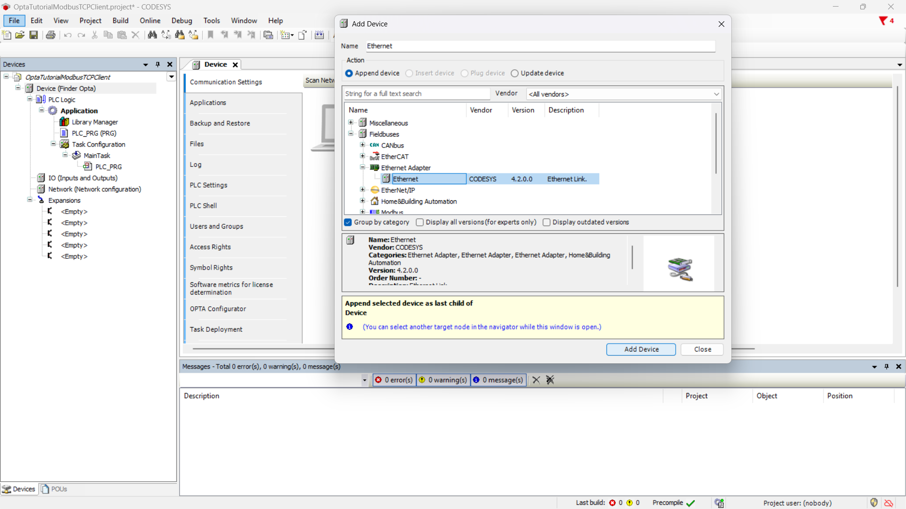

Now, double-click on the `Ethernet (Ethernet)` item in the side menu.

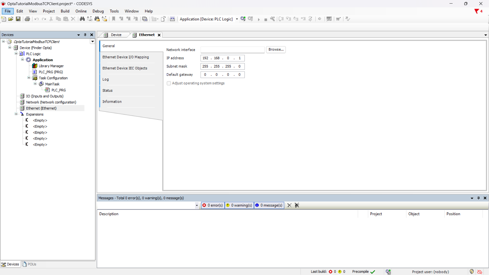

At this point, read the network configuration from the Finder OPTA: clicking
the `Browse...` button will open a window with the network parameters of the
connected device. Make sure the values are the ones of the Finder OPTA acting
as client:

- IP Address: `10.0.0.3`
- Subnet Mask: `255.255.255.0`
- Default Gateway: `10.0.0.1`

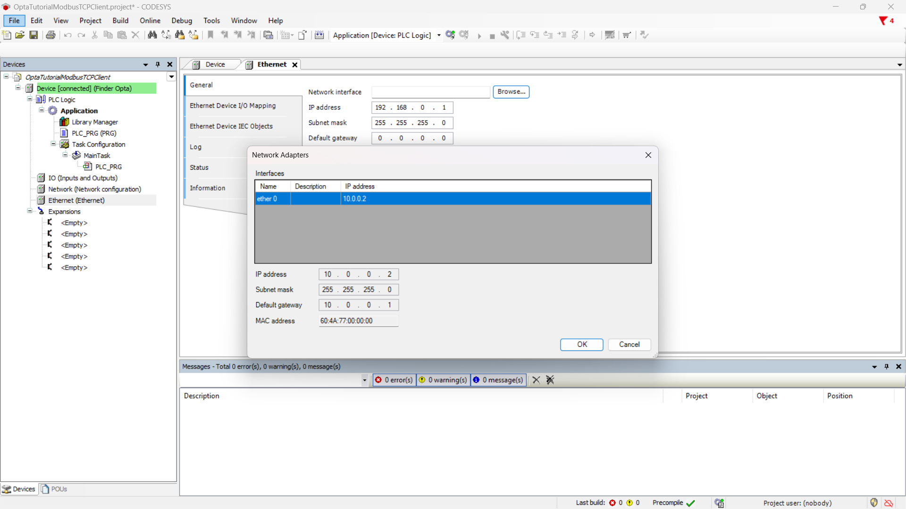

Press `OK` to keep the Finder OPTA network parameters. Before continuing,
remember to check the `Adapt operating system settings` option and then click
`Yes` to confirm the change.

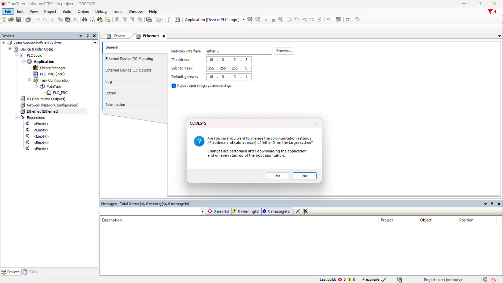

The network parameters are now set in the CODESYS project, but they are not
stored on the device yet: to save them on the Finder OPTA you need to download
the program to it. Press the green button at the top labeled `Login` and
confirm the download.

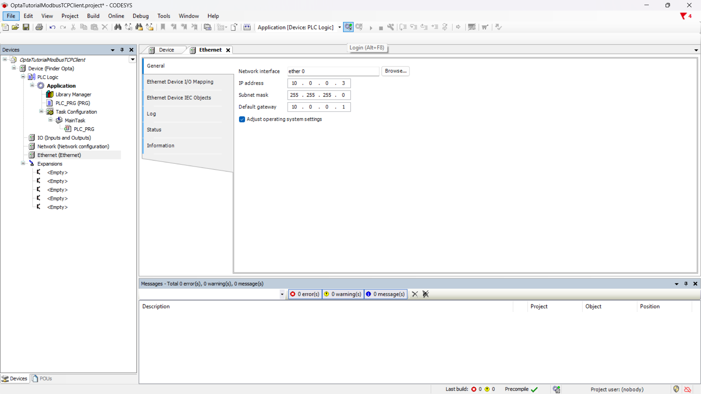

During this step CODESYS may return an error like the one shown below. This
happens because the Finder OPTA has just changed its IP address, so the project
is still pointing to the previous one. In this case simply repeat the network
scan we saw in the first steps - double-click the `Device (Finder Opta)` item,
click `Scan network` and select the Finder OPTA - to align the project with the
new IP address of the device, then press `Login` again.

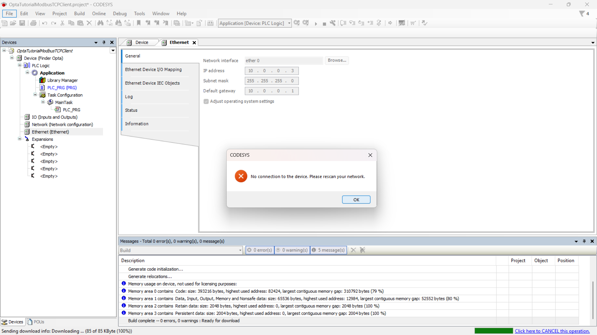

### Preparing the ST program

Open `PLC_PRG`. In the declaration area enter:

```st
PROGRAM PLC_PRG
VAR
    inputCoil_0 : BOOL := FALSE;
    inputCoil_1 : BOOL := FALSE;
    inputCoil_2 : BOOL := FALSE;
    inputCoil_3 : BOOL := FALSE;
    led_1 : BOOL := FALSE;
    led_2 : BOOL := FALSE;
    led_3 : BOOL := FALSE;
    led_4 : BOOL := FALSE;
    outputCoil_0 : BOOL := FALSE;
    outputCoil_1 : BOOL := FALSE;
    outputCoil_2 : BOOL := FALSE;
    outputCoil_3 : BOOL := FALSE;
END_VAR
```

In the implementation area enter:

```st
led_1 := inputCoil_0;
led_2 := inputCoil_1;
led_3 := inputCoil_2;
led_4 := inputCoil_3;

outputCoil_0 := inputCoil_0;
outputCoil_1 := inputCoil_1;
outputCoil_2 := inputCoil_2;
outputCoil_3 := inputCoil_3;
```

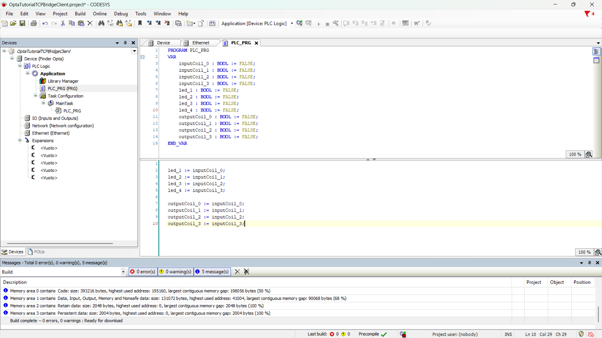

The `inputCoil` variables receive commands from the local
Modbus server. The `led_` variables drive the physical LEDs,
and the `outputCoil` variables will provide the values for the
client channels added in the next stage.

### Adding the local Modbus TCP server

Right-click `Ethernet`, select `Add Device...`,
then expand `Modbus` > `ModbusTCP Slave Device`
and add `ModbusTCP Server Device`. This is the local server
that receives requests addressed to Opta A.

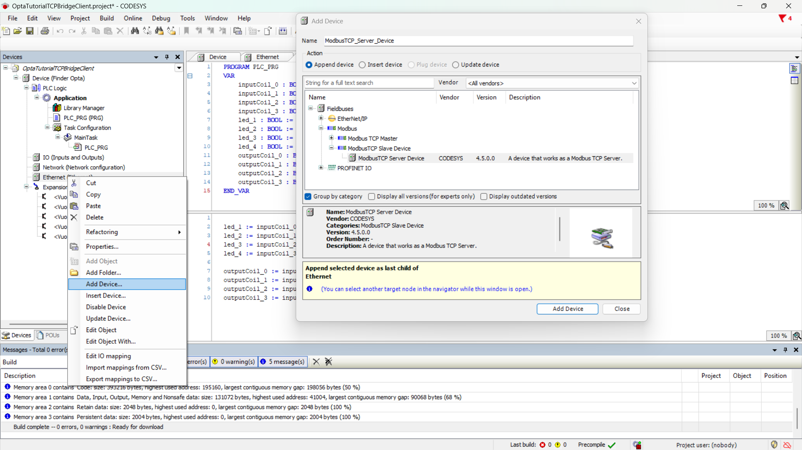

Open its `General` tab and configure:

- Server port: `502`.
- Discrete Bit Areas: enabled.
- Coils (number of coils): `4`, or the smallest supported
  count that includes four coils.
- Coils (starting address): `0`.
- Holding registers and Input registers: keep the minimum supported
  counts; these are unused.
- Watchdog: disabled for this demonstration.

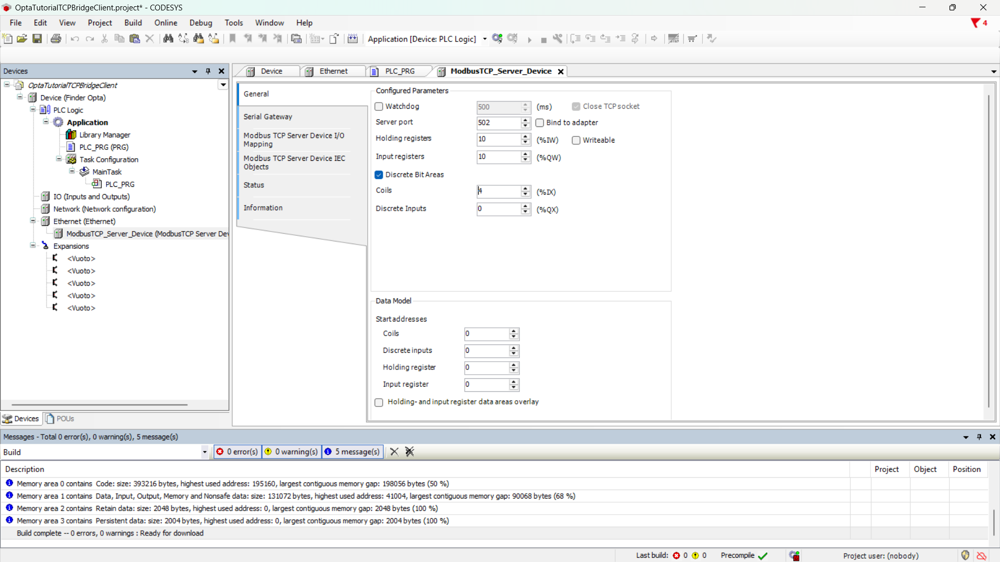

Keep the holding and input register areas separate.
`Discrete Bit Areas` gives coils their own data area instead
of sharing the register memory, as explained in the [CODESYS
server configuration reference](https://content.helpme-codesys.com/en/CODESYS%20Modbus/_mod_edt_slave_device_tcp.html).

### Mapping the received coils and LEDs

Open `Modbus TCP Server Device I/O Mapping` and expand the
coil area.

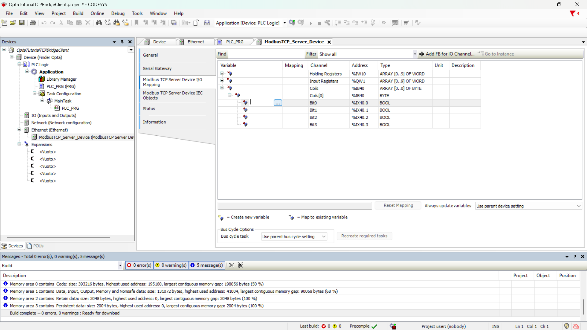

Double-click the first coil's `Variable` cell and use the
options button to select `inputCoil_0` under
`Application` > `PLC_PRG`, then press
`OK`.

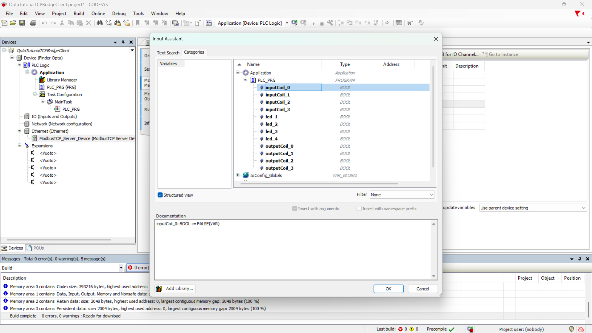

Repeat the operation for the other coils until the mapping is as
follows:

- Coil address `0`: `PLC_PRG.inputCoil_0`.
- Coil address `1`: `PLC_PRG.inputCoil_1`.
- Coil address `2`: `PLC_PRG.inputCoil_2`.
- Coil address `3`: `PLC_PRG.inputCoil_3`.

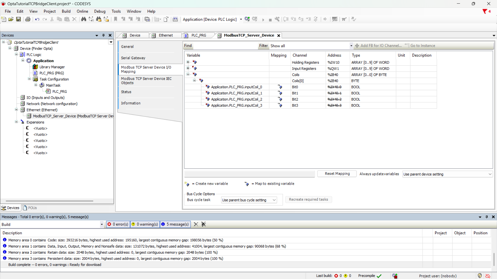

If the driver displays coils as bits inside a byte, expand that byte
and map the individual bit rows. Leave the parent byte unmapped when
mapping its bits; the [CODESYS
I/O Mapping reference](https://content.helpme-codesys.com/en/CODESYS%20Development%20System/_cds_edt_device_io_mapping.html) explains this restriction.

Now open `I/O` > `Opta I/O Mapping` and
locate the LED outputs.

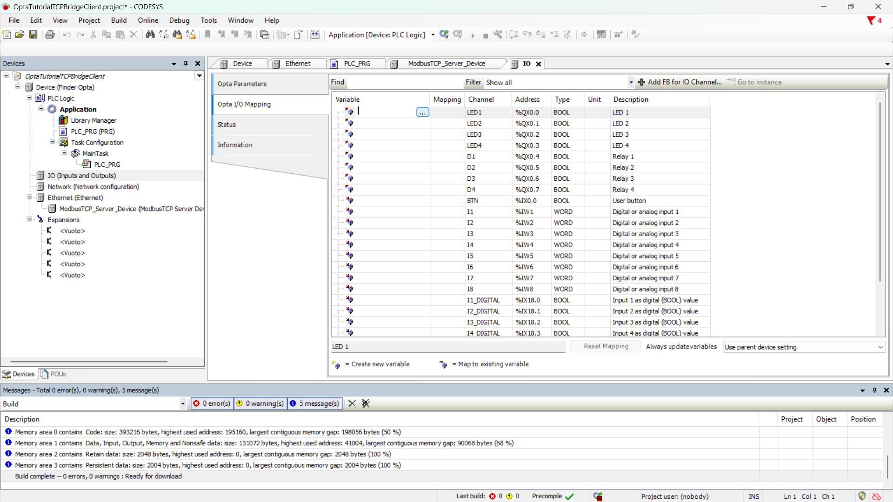

Use the variable selector to assign each LED output:

- LED 1: `PLC_PRG.led_1`.
- LED 2: `PLC_PRG.led_2`.
- LED 3: `PLC_PRG.led_3`.
- LED 4: `PLC_PRG.led_4`.

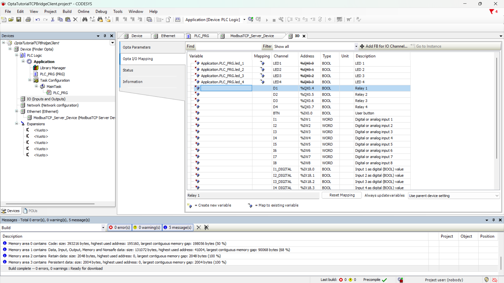

### Verifying Opta A with mbpoll

Press `Login` to download the project, then
`Start` to run it.

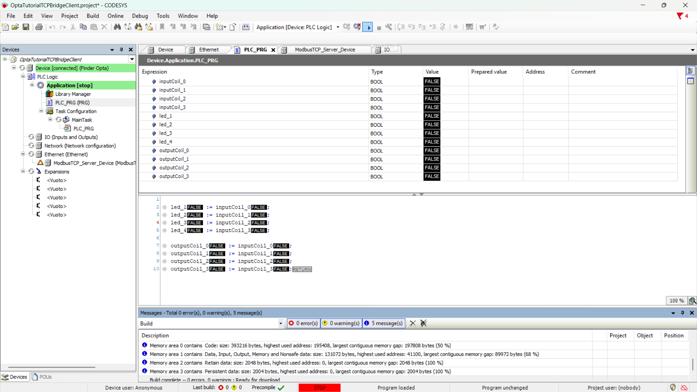

From a terminal on your PC, first try to read from coil address `0` with the following command:

```sh
mbpoll -m tcp -t 0 -0 -r 0 -1 10.0.0.3
```

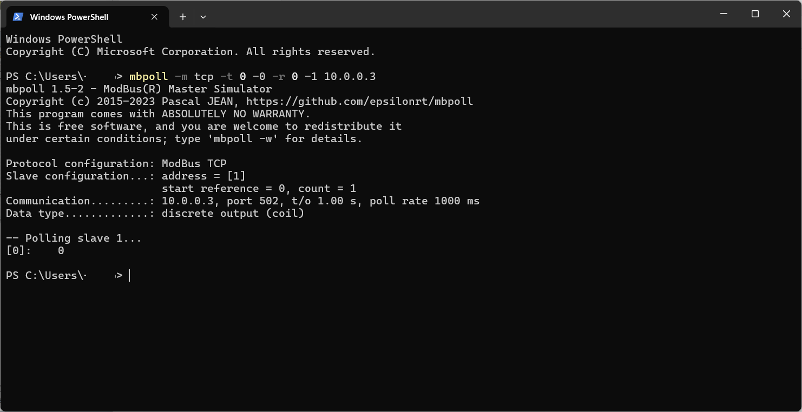

Then write ON to coil address `0`:

```sh
mbpoll -m tcp -t 0 -0 -r 0 -1 10.0.0.3 1
```


LED 1 of Opta A should switch on.

In CODESYS, check that the `coil`, `led`, and
`outputCoil` variables all follow the commands. Complete this
test before adding the client configuration.

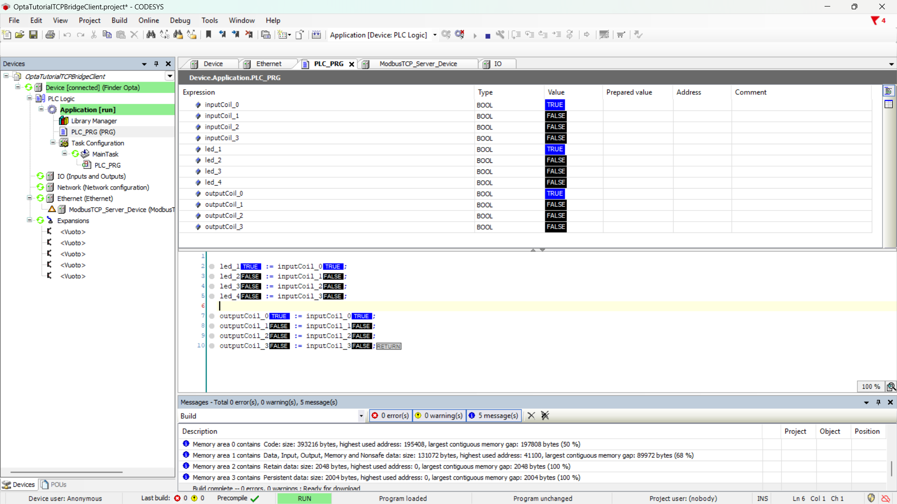

Write OFF to the same coil:

```sh
mbpoll -m tcp -t 0 -0 -r 0 -1 10.0.0.3 0
```

LED 1 of Opta A should switch off.

In the mbpoll command

- `-m tcp` selects Modbus TCP
- `-t 0` selects coils
- `-0` selects zero-based addressing
- `-r` selects the starting address
- `-1` limits polling to one read
- `10.0.0.3` is the Opta A IP address
- `0` or `1` is the value to be written to coil

See the [mbpoll command reference](https://github.com/epsilonrt/mbpoll/blob/master/doc/mbpoll.1).

## Configuring the client side of Opta A

Save the project and log out to add the client. Keep the local server
in the project: Opta A needs both roles on the same Ethernet
interface.

### Adding the client and remote server

Right-click `Ethernet`, select `Add Device...`,
and add `Modbus TCP Client` from the `Modbus`
category.

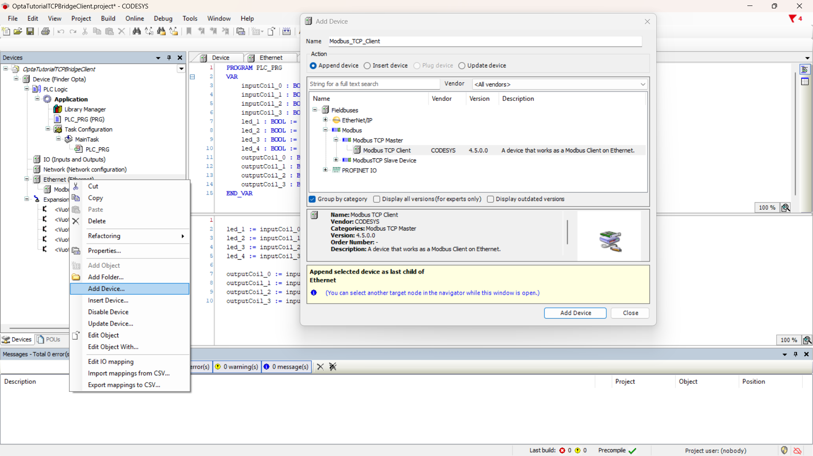

Open the client and keep a response timeout of `1000` ms
for this example.

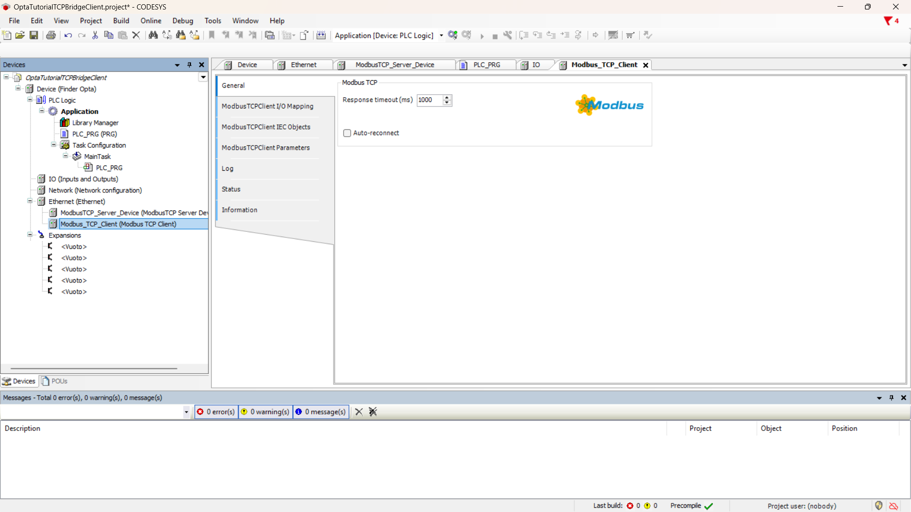

Right-click `Modbus_TCP_Client (Modbus TCP Client)`,
select `Add Device...`, and add
`Modbus TCP Server`. This child node describes the remote
Opta B; the local listening server remains the separate
`ModbusTCP Server Device`.

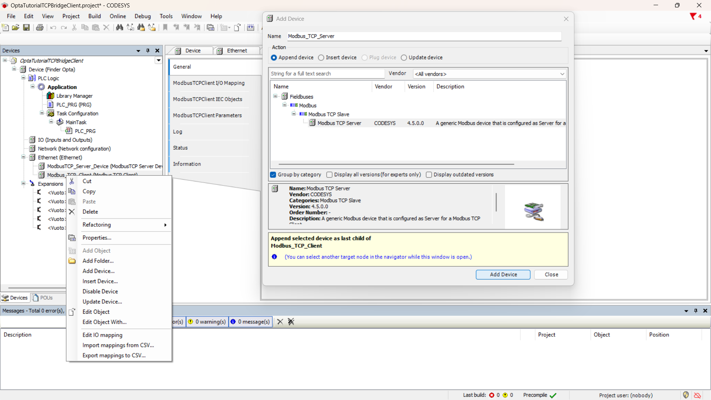

Open the new remote server node and configure:

- Server IP address: `10.0.0.2`
- Response timeout: `1000` ms
- Port: `502`

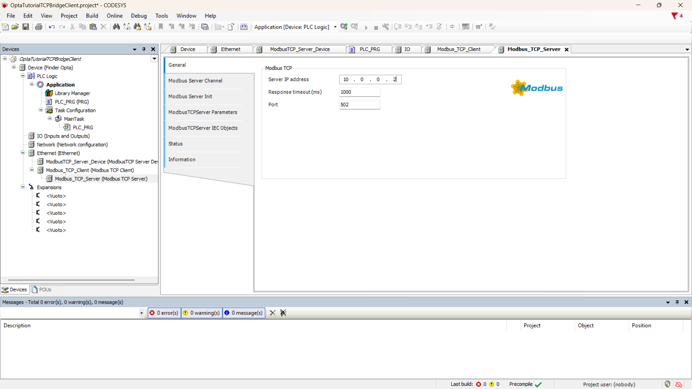

### Adding four Write Single Coil channels

On the remote server node, open `Modbus Server Channel`
and click `Add channel`.

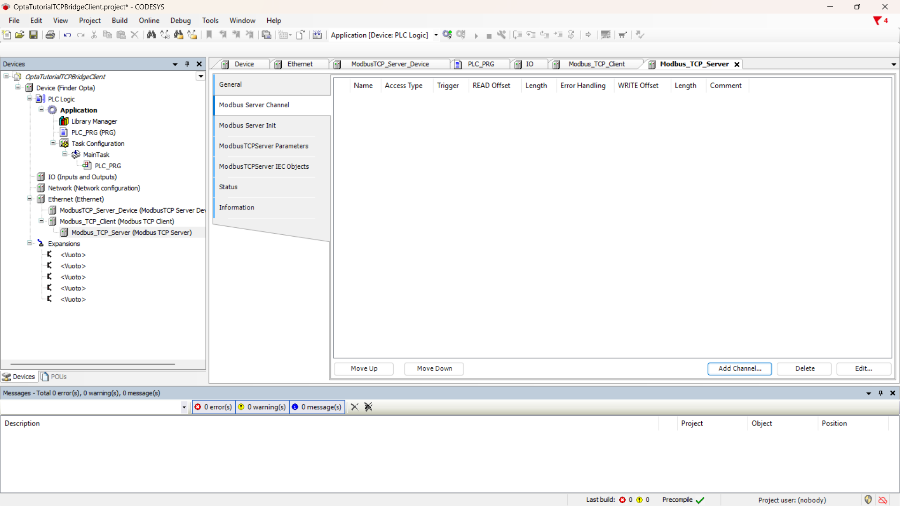

Configure the first channel as follows:

- Name: `Channel 0`.
- Access type: `Write Single Coil (Function code 5)`.
- Write register offset: `0x0000`.
- Trigger: `Cyclic`.
- Cycle time: `100` ms.

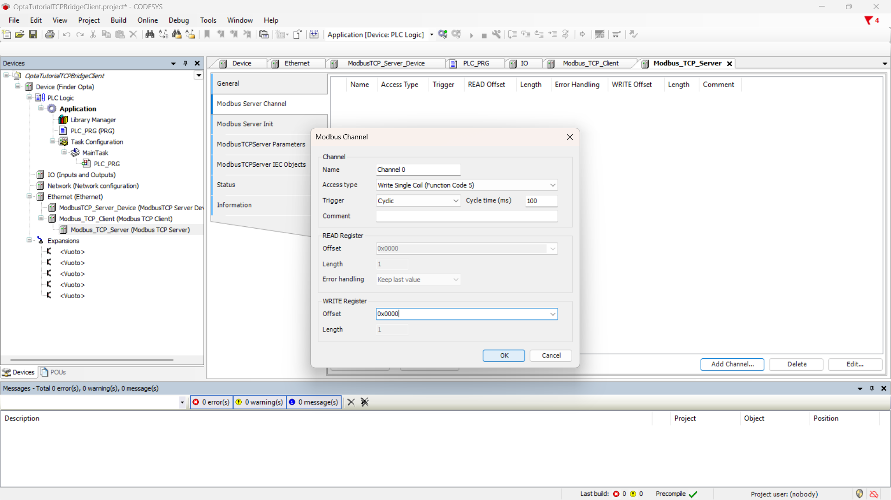

Press `OK`, then add the other three channels with the
same access type, trigger, and cycle time. Change the name and write
offset for each one:

- `Channel 1`: write offset `1` /
  `0x0001`.
- `Channel 2`: write offset `2` /
  `0x0002`.
- `Channel 3`: write offset `3` /
  `0x0003`.

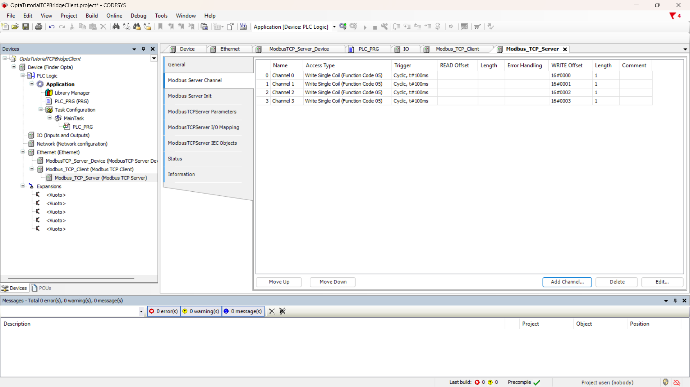

FC05 writes one coil per request. If a write length is displayed, it
is `1`. Use the **write** offset field. Each
channel periodically sends its current value, including
`FALSE`, so turning a LED off is propagated as well.

### Mapping the values to transmit

Open the remote server's `ModbusTCPServer I/O Mapping`
tab.

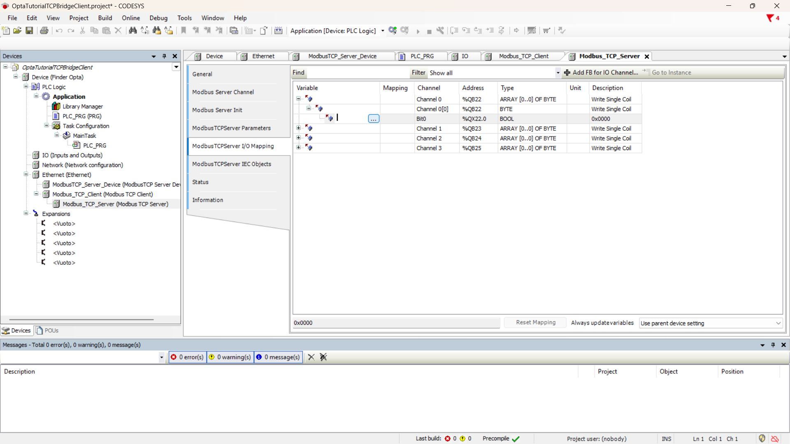

Double-click the `Variable` cell of the first channel's
Boolean output value, use the options button to select
`outputCoil_0` under `Application` >
`PLC_PRG`, and press `OK`.

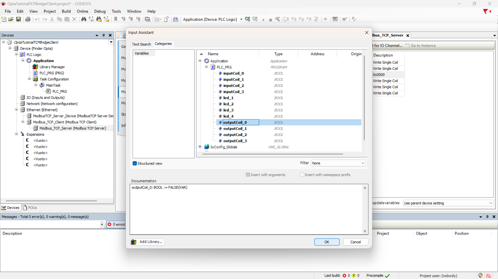

Repeat the operation for the other three channels:

- `Channel 0`: `PLC_PRG.outputCoil_0`.
- `Channel 1`: `PLC_PRG.outputCoil_1`.
- `Channel 2`: `PLC_PRG.outputCoil_2`.
- `Channel 3`: `PLC_PRG.outputCoil_3`.

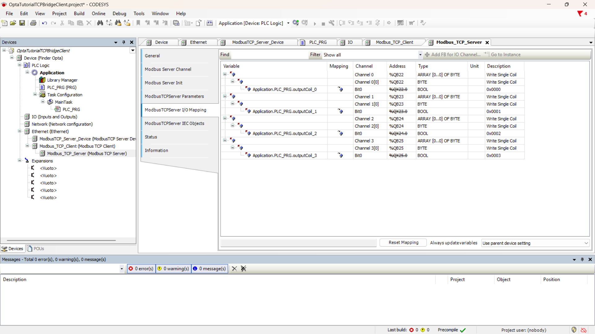

No further ST logic is needed: the assignments already copy the
received states into these output variables. Save the project.
Communication to Opta B can report errors until its server is configured
and running.

## Adapting Opta B from the server tutorial

Create a new CODESYS project by following the [Modbus TCP
server tutorial](../CodesysOptaModbusTCPServerTutorial/content.md), up to and
including the section on downloading the program to Finder OPTA. This gives
you a working Modbus TCP server project to use as the starting point for
Opta B in this tutorial. You can skip the HMI sections. In the following
steps, we will adapt the counter example to control the four LEDs through coils.

### Network and server configuration

Select Opta B with `Scan network`. Its Ethernet
configuration must use IP address `10.0.0.2` and subnet mask
`255.255.255.0`, matching the remote server node in the Opta
A project.

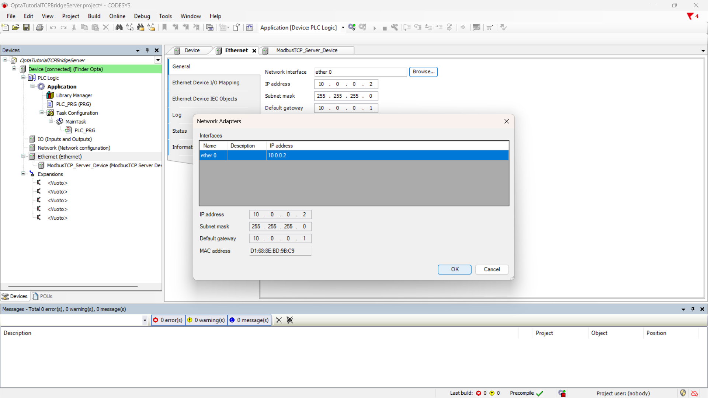

On its existing `ModbusTCP Server Device`, keep port
`502`, enable `Discrete Bit Areas` and configure at
least four coils.

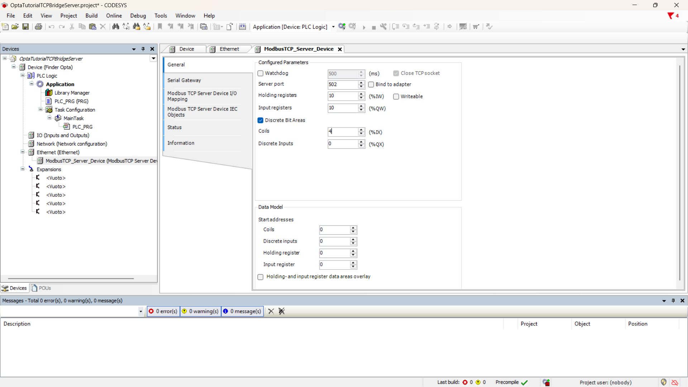

The previous tutorial starts the registers at `1`. Those
are register addresses: explicitly set the **coil**
starting address to `0` for this example. Opta A's four write
offsets must match this coil area.

### Replacing the counter program and mapping the LEDs

Remove the previous `mbCount` Input Register mapping
before replacing the counter program. In the declaration area of
`PLC_PRG` enter:

```st
PROGRAM PLC_PRG
VAR
    inputCoil_0 : BOOL := FALSE;
    inputCoil_1 : BOOL := FALSE;
    inputCoil_2 : BOOL := FALSE;
    inputCoil_3 : BOOL := FALSE;
    led_1 : BOOL := FALSE;
    led_2 : BOOL := FALSE;
    led_3 : BOOL := FALSE;
    led_4 : BOOL := FALSE;
END_VAR
```

In the implementation area enter:

```st
led_1 := inputCoil_0;
led_2 := inputCoil_1;
led_3 := inputCoil_2;
led_4 := inputCoil_3;
```

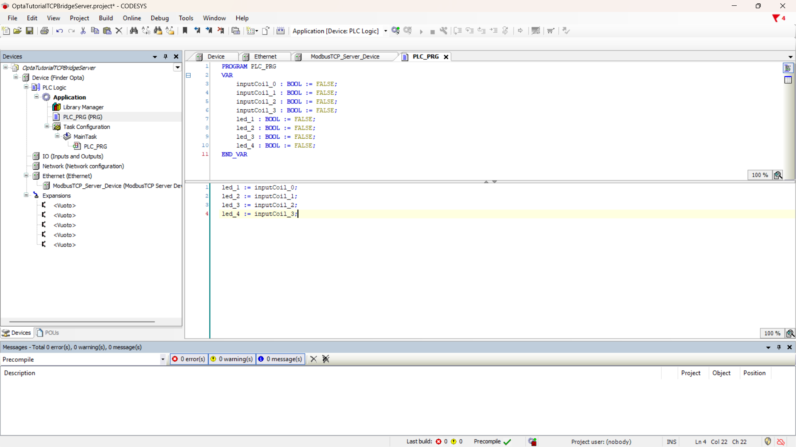

Open `Modbus TCP Server Device I/O Mapping` and expand the coil area
to show the incoming coil bits. Double-click the first coil's `Variable`
cell to make the options button appear.

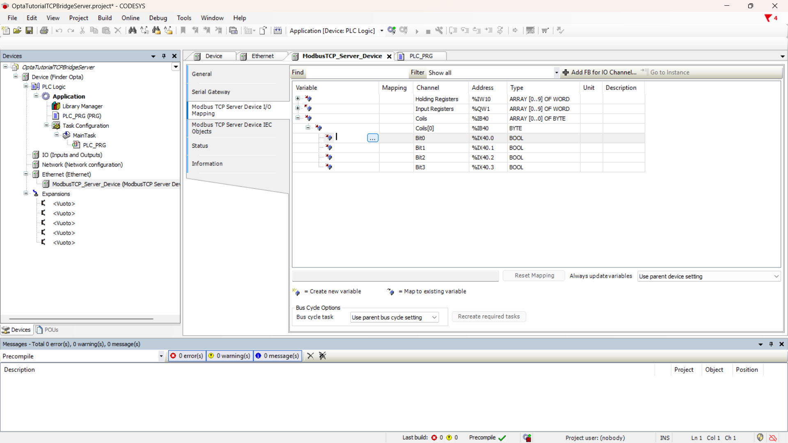

Click the options button, expand `Application` and then `PLC_PRG`,
select `inputCoil_0`, and press `OK`.

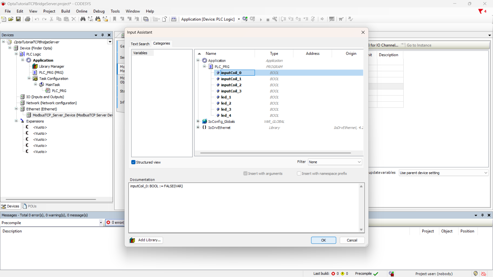

Repeat the operation for the remaining coils until the mapping is as follows:

- Coil address `0`: `PLC_PRG.inputCoil_0`.
- Coil address `1`: `PLC_PRG.inputCoil_1`.
- Coil address `2`: `PLC_PRG.inputCoil_2`.
- Coil address `3`: `PLC_PRG.inputCoil_3`.

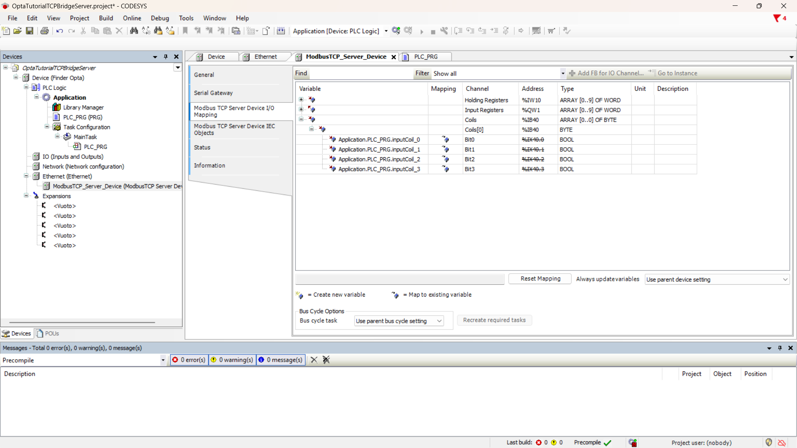

Now open `I/O` > `Opta I/O Mapping` and locate the LED outputs.
Double-click the `Variable` cell for LED 1 to make the options button appear.

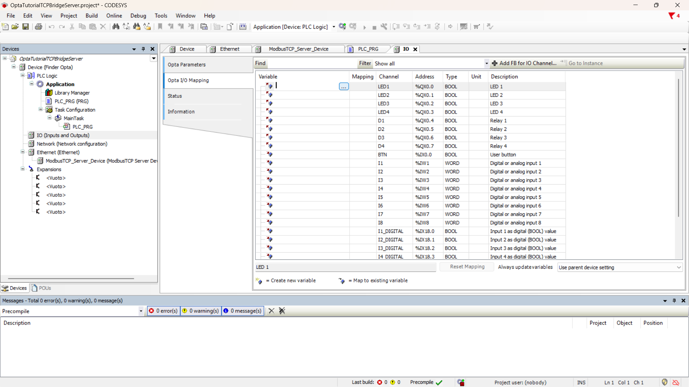

Click the options button, expand `Application` and then `PLC_PRG`,
select `led_1`, and press `OK`.

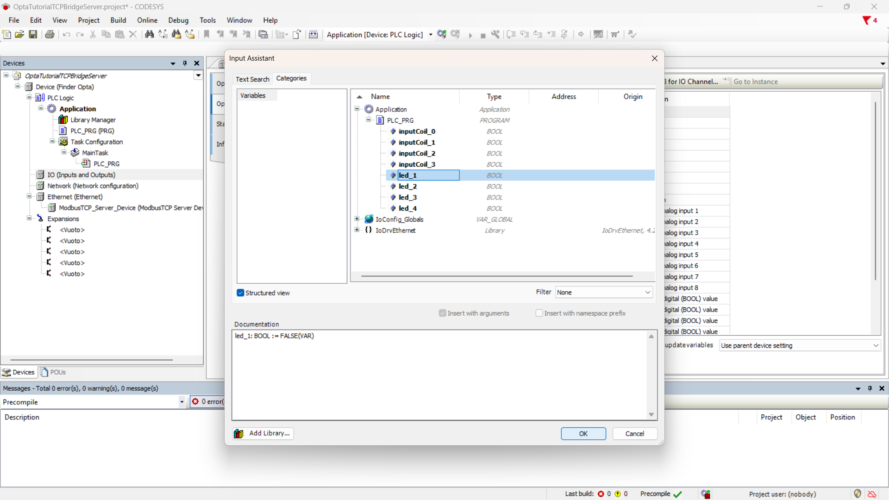

Repeat the operation for the other LEDs until each output is assigned
to its corresponding variable:

- LED 1: `PLC_PRG.led_1`.
- LED 2: `PLC_PRG.led_2`.
- LED 3: `PLC_PRG.led_3`.
- LED 4: `PLC_PRG.led_4`.

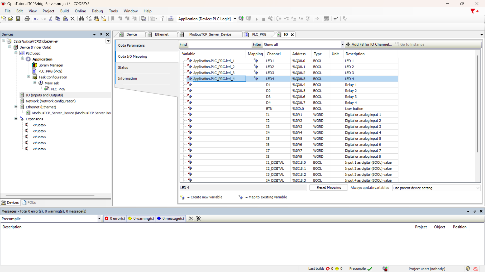

Opta B needs no Modbus TCP client and no timer: its server receives
the writes, and its PLC task applies the values to the LEDs.

### Downloading and checking Opta B

Download the Opta B project with `Login` and run it with
`Start`.

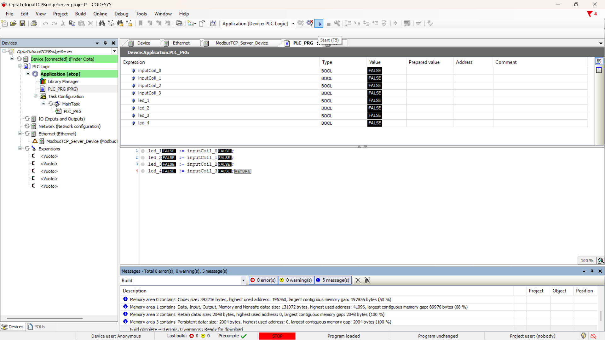

Before running the complete bridge, test Opta B directly from the
PC as done before with Opta A:

```sh
mbpoll -m tcp -t 0 -0 -r 0 -1 10.0.0.2 1
```


LED 1 should switch on, the read should report coil `0` as `1`.

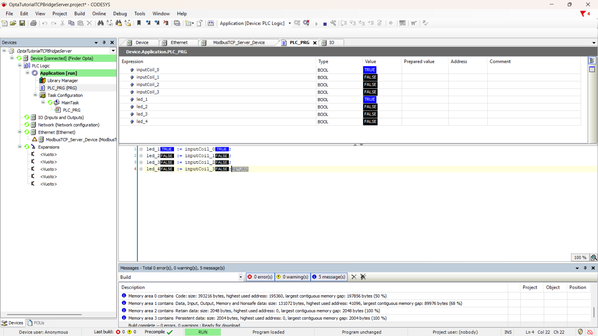

Repeat with addresses `1`, `2`, and `3`.

Save and `Logout` from Opta B without pressing
`Stop`, so its application keeps running while you return to
the Opta A project.

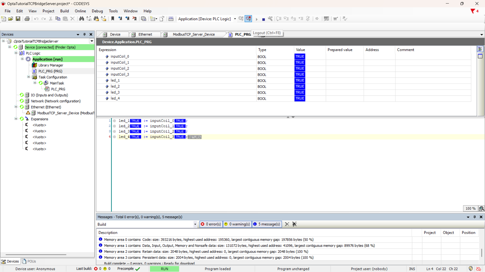

## Testing the complete bridge

Open the Opta A project, check that the selected device is
`10.0.0.3`, download the updated configuration with
`Login`, and press `Start`. Both applications must
now be running.

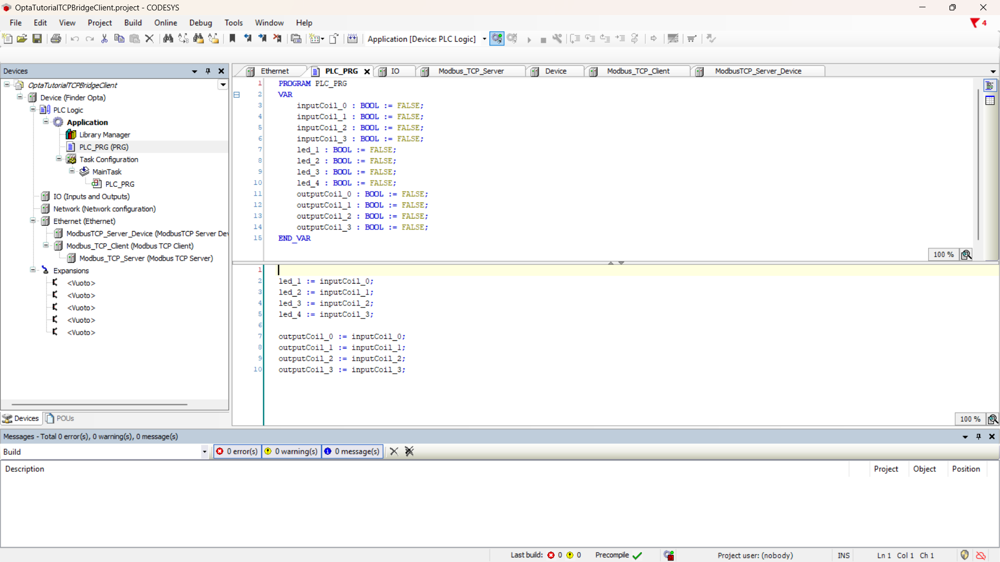

Send these commands to **Opta A only**, reading both
devices after each write:

- Turn on LED 1:
  `mbpoll -m tcp -t 0 -0 -r 0 -1 10.0.0.3 1`.
- Turn on LED 2:
  `mbpoll -m tcp -t 0 -0 -r 1 -1 10.0.0.3 1`.
- Turn on LED 3:
  `mbpoll -m tcp -t 0 -0 -r 2 -1 10.0.0.3 1`.
- Turn on LED 4:
  `mbpoll -m tcp -t 0 -0 -r 3 -1 10.0.0.3 1`.
- Repeat each command with final value `0` to turn the
  corresponding LED off.

Read the coil states on both devices:

```sh
mbpoll -m tcp -t 0 -0 -r 0 -c 4 -1 10.0.0.3
mbpoll -m tcp -t 0 -0 -r 0 -c 4 -1 10.0.0.2
```


After allowing the client channels to execute, both reads should show
the same four values. A successful write response from Opta A confirms
only the PC-to-Opta-A transaction. Check Opta B's coils and LEDs to
confirm delivery through the second transaction.

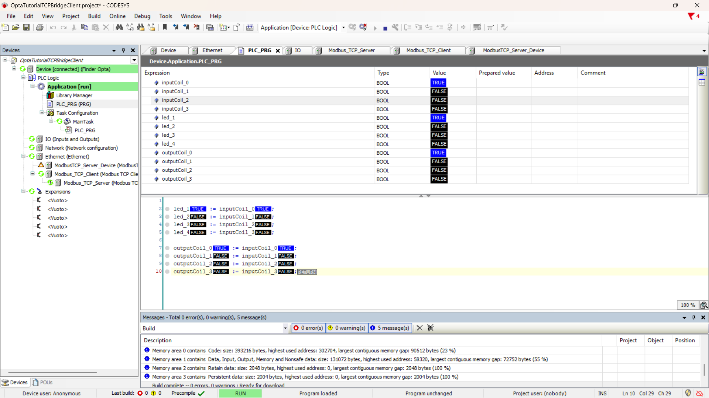

Check the physical LEDs on both devices as well: each pair of
corresponding LEDs should follow the same ON/OFF command.

## Troubleshooting

If Opta A's LEDs respond but Opta B's do not, check the two
communication steps separately:

- If the PC cannot write to an Opta, check the IP addresses, subnet,
  server port `502`, and that the application is running.
- If a write succeeds but the local LED does not change, check the
  incoming coil bit mapping, LED output mapping, and any assignments
  overwriting coil variables.
- If Opta A's LEDs work but its write values stay unchanged, check the
  ST assignments and the four client output mappings.
- If the client reports a timeout or no connection, check the remote
  IP `10.0.0.2`, port, Opta B application, and Ethernet
  connection.

To test Opta B directly, stop Opta A's application temporarily and
repeat the direct `mbpoll` test. If that succeeds, return to
Opta A and inspect the remote server's `Status`, channel
diagnostics, and current output values online. Reduce the test to the
first FC05 channel if necessary.

Check that every channel uses `Cyclic` and that its write
value is mapped to the intended `outputCoil` variable. Confirm
the selected bus task actually runs `PLC_PRG`. Changing a bus
cycle setting does not fix an incorrect destination IP, offset, or data
mapping.

After verifying the bridge, save both working projects and record the
CODESYS, OPTA plug-in, and runtime versions, together with the task and
channel periods. This provides a reference configuration when extending
the example.

## Conclusions

You have configured Opta A to receive four coil commands from a PC,
drive its own LEDs, and write the same states to Opta B through four
cyclic FC05 channels. Opta B receives those writes through its server
and applies them to its LEDs.
